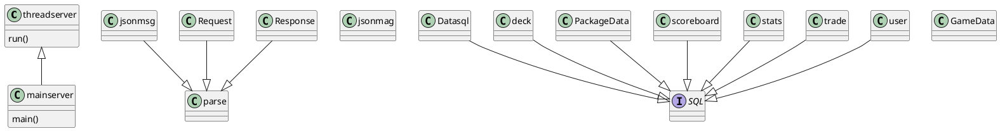
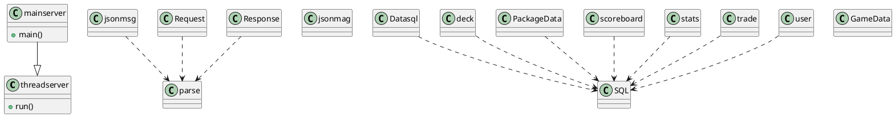

# Case E001

Diagram type: class · tier 3 · outcome: compiled low-structural
Image: `E001.png`

## Ground truth

## Answer (0 display-only lines removed; they are in `E001.stripped.txt`)

## Structural diff

Element F1 1.000 · Relationship F1 0.091

- nodes matched (16): `datasql`, `deck`, `gamedata`, `jsonmag`, `jsonmsg`, `mainserver`, `packagedata`, `parse`, `request`, `response`, `scoreboard`, `sql`, `stats`, `threadserver`, `trade`, `user`
- nodes missed (0): none
- nodes spurious (0): none
- edges matched (1): `mainserver -> threadserver : inheritance`
- edges missed (10): `datasql -> sql : inheritance`, `deck -> sql : inheritance`, `jsonmsg -> parse : inheritance`, `packagedata -> sql : inheritance`, `request -> parse : inheritance`, `response -> parse : inheritance`, `scoreboard -> sql : inheritance`, `stats -> sql : inheritance`, `trade -> sql : inheritance`, `user -> sql : inheritance`
- edges spurious (10): `datasql -> sql : dependency`, `deck -> sql : dependency`, `jsonmsg -> parse : dependency`, `packagedata -> sql : dependency`, `request -> parse : dependency`, `response -> parse : dependency`, `scoreboard -> sql : dependency`, `stats -> sql : dependency`, `trade -> sql : dependency`, `user -> sql : dependency`
