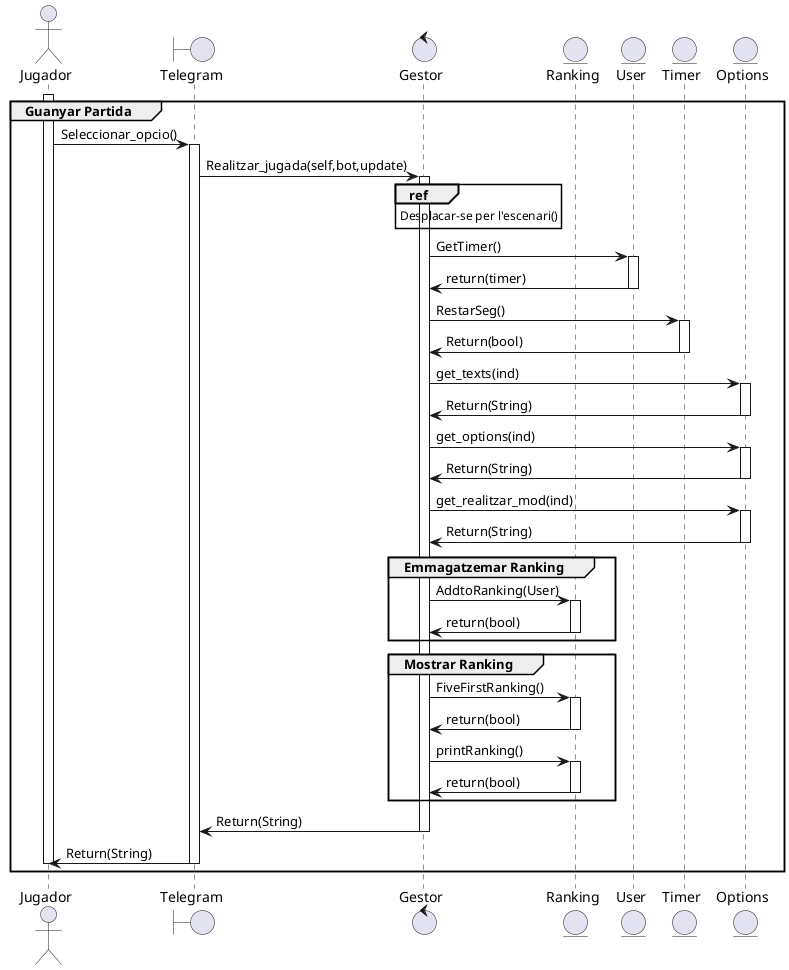

# Case E002

Diagram type: sequence · tier 4 · outcome: compile fail
Image: `E002.png`

## Ground truth



## Answer (0 display-only lines removed; they are in `E002.stripped.txt`)

```plantuml
@startuml
actor Jugador
participant Telegram
control Gestor
entity Ranking
entity User
entity Timer
entity Options

frame "Guanyar Partida" {
    Jugador -> Telegram: Seleccionar_opcio()
    activate Telegram
    Telegram -> Gestor: Realitzar_jugada(self,bot,update)
    activate Gestor
    
    ref over Gestor: Desplaçar-se per l'escenari()
    
    Gestor -> Timer: GetTimer()
    activate Timer
    Timer --> Gestor: return(timer)
    deactivate Timer
    
    Gestor -> Timer: RestarSeg()
    activate Timer
    Timer --> Gestor: Return(bool)
    deactivate Timer
    
    Gestor -> Options: get_texts(ind)
    activate Options
    Options --> Gestor: Return(String)
    deactivate Options
    
    Gestor -> Options: get_options(ind)
    activate Options
    Options --> Gestor: Return(String)
    deactivate Options
    
    Gestor -> Options: get_realitzar_mod(ind)
    activate Options
    Options --> Gestor: Return(String)
    deactivate Options
    
    frame "Emmagatzemar Ranking" {
        Gestor -> Ranking: AddtoRanking(User)
        activate Ranking
        Ranking --> Gestor: return(bool)
        deactivate Ranking
    }
    
    frame "Mostrar Ranking" {
        Gestor -> Ranking: FiveFirstRanking()
        activate Ranking
        Ranking --> Gestor: return(bool)
        deactivate Ranking
        
        Gestor -> Ranking: printRanking()
        activate Ranking
        Ranking --> Gestor: return(bool)
        deactivate Ranking
    }
    
    Gestor --> Telegram: Return(String)
    deactivate Gestor
    Telegram --> Jugador: Return(String)
    deactivate Telegram
}
@enduml
```

## Renderer

Renderer: error at line 10 of the answer block: `frame "Guanyar Partida" {`
