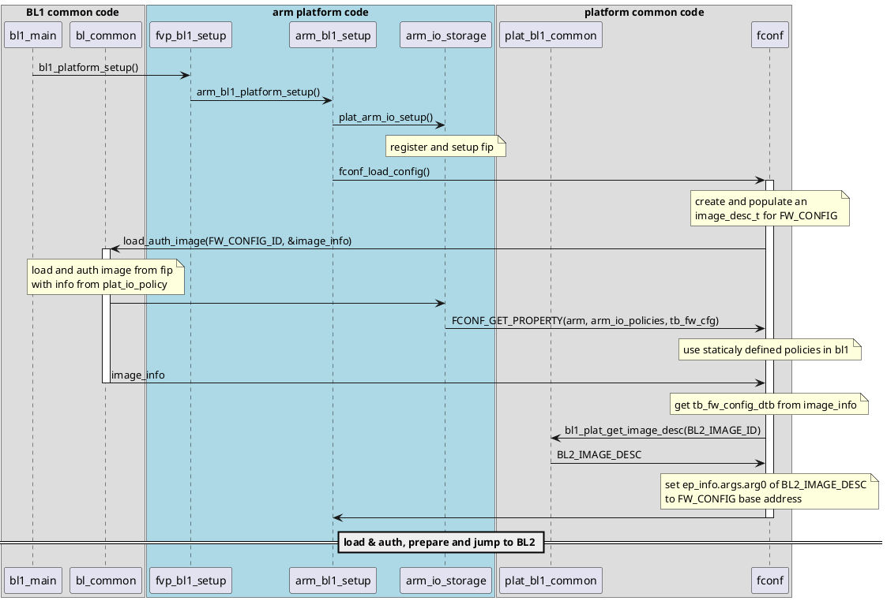

# Case E003

Diagram type: sequence · tier 4 · outcome: compiled low-structural
Image: `E003.png`

## Ground truth

## Answer (3 display-only lines removed; they are in `E003.stripped.txt`)

```plantuml
@startuml

package "BL1 common code" {
  [bl1_main]
  [bl_common]
}

package "arm platform code" {
  [fvp_bl1_setup]
  [arm_bl1_setup]
  [arm_io_storage]
}

package "platform common code" {
  [plat_bl1_common]
  [fconf]
}

note right of bl1_main
  load and auth image from fip
  with info from plat_io_policy
end note

note right of fconf
  create and populate an
  image_desc_t for FW_CONFIG
end note

note right of fconf
  use statically defined policies in bl1
end note

note right of fconf
  get tb_fw_config_dtb from image_info
end note

note right of fconf
  set ep_info.args.arg0 of BL2_IMAGE_DESC
  to FW_CONFIG base address
end note

note right of arm_bl1_setup
  register and setup fip
end note

note right of bl1_main
  load & auth, prepare and jump to BL2
end note

bl1_main -> fvp_bl1_setup : bl1_platform_setup()
fvp_bl1_setup -> arm_bl1_setup : arm_bl1_platform_setup()
arm_bl1_setup -> arm_io_storage : plat_arm_io_setup()
arm_bl1_setup -> fconf : fconf_load_config()
fconf -> fconf : create and populate an image_desc_t for FW_CONFIG
fconf -> bl1_main : load_auth_image(FW_CONFIG_ID, &image_info)
bl1_main -> fconf : FCONF_GET_PROPERTY(arm, arm_io_policies, tb_fw_cfg)
fconf -> fconf : use statically defined policies in bl1
fconf -> fconf : get tb_fw_config_dtb from image_info
plat_bl1_common -> fconf : bl1_plat_get_image_desc(BL2_IMAGE_ID)
fconf -> plat_bl1_common : BL2_IMAGE_DESC
plat_bl1_common -> fconf : set ep_info.args.arg0 of BL2_IMAGE_DESC to FW_CONFIG base address
fconf -> bl1_main : load & auth, prepare and jump to BL2

@enduml
```

## Structural diff

Element F1 0.667 · Relationship F1 0.000

- nodes matched (7): `arm_bl1_setup`, `arm_io_storage`, `bl1_main`, `bl_common`, `fconf`, `fvp_bl1_setup`, `plat_bl1_common`
- nodes missed (0): none
- nodes spurious (7): `create and populate an image_desc_t for fw_config`, `get tb_fw_config_dtb from image_info`, `load & auth, prepare and jump to bl2`, `load and auth image from fip with info from plat_io_policy`, `register and setup fip`, `set ep_info.args.arg0 of bl2_image_desc to fw_config base address`, `use statically defined policies in bl1`
- edges matched (0): none
- edges missed (11): `arm_bl1_setup -> arm_io_storage : message`, `arm_bl1_setup -> fconf : message`, `arm_io_storage -> fconf : message`, `bl1_main -> fvp_bl1_setup : message`, `bl_common -> arm_io_storage : message`, `bl_common -> fconf : message`, `fconf -> arm_bl1_setup : message`, `fconf -> bl_common : message`, `fconf -> plat_bl1_common : message`, `fvp_bl1_setup -> arm_bl1_setup : message`, `plat_bl1_common -> fconf : message`
- edges spurious (20): `arm_bl1_setup -> arm_io_storage : association (one arrowhead)`, `arm_bl1_setup -> fconf : association (one arrowhead)`, `arm_bl1_setup -> register and setup fip : dependency`, `bl1_main -> fconf : association (one arrowhead)`, `bl1_main -> fvp_bl1_setup : association (one arrowhead)`, `bl1_main -> load & auth, prepare and jump to bl2 : dependency`, `bl1_main -> load and auth image from fip with info from plat_io_policy : dependency`, `fconf -> bl1_main : association (one arrowhead)` ×2, `fconf -> create and populate an image_desc_t for fw_config : dependency`, `fconf -> fconf : association (one arrowhead)` ×3, `fconf -> get tb_fw_config_dtb from image_info : dependency`, `fconf -> plat_bl1_common : association (one arrowhead)`, `fconf -> set ep_info.args.arg0 of bl2_image_desc to fw_config base address : dependency`, `fconf -> use statically defined policies in bl1 : dependency`, `fvp_bl1_setup -> arm_bl1_setup : association (one arrowhead)`, `plat_bl1_common -> fconf : association (one arrowhead)` ×2
