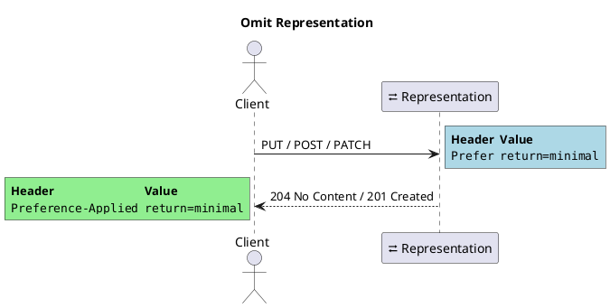
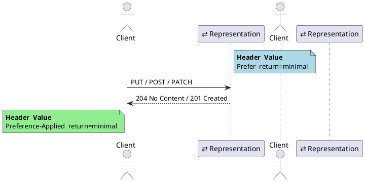

# Case E004

Diagram type: sequence · tier 2 · outcome: compiled low-structural
Image: `E004.png`

## Ground truth

## Answer (2 display-only lines removed; they are in `E004.stripped.txt`)

## Structural diff

Element F1 0.333 · Relationship F1 0.000

- nodes matched (1): `client`
- nodes missed (1): `representation`
- nodes spurious (3): `? representation` ×2, `client`
- edges matched (0): none
- edges missed (2): `client -> representation : message`, `representation -> client : message`
- edges spurious (2): `? representation -> client : message`, `client -> ? representation : message`
