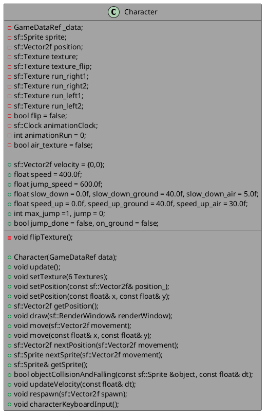

# Case E005

Diagram type: class · tier 3 · outcome: compile fail
Image: `E005.png`

## Ground truth



## Answer (0 display-only lines removed; they are in `E005.stripped.txt`)

```plantuml

```

## Renderer

The answer has no `@enduml`. Renderer: no PNG produced
