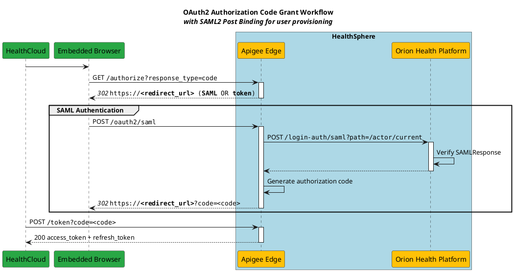

# Case E006

Diagram type: sequence · tier 3 · outcome: compile fail
Image: `E006.png`

## Ground truth



## Answer (1 display-only lines removed; they are in `E006.stripped.txt`)

```plantuml
@startuml

participant HealthCloud as HC
participant Embedded Browser as EB
participant Apigee Edge as AE
participant Orion Health Platform as OHP

note over AE, OHP
OAuth2 Authorization Code Grant Workflow<br/>with SAML2 Post Binding for user provisioning
end note

HC ->> EB: GET /authorize?response_type=code
EB ->> AE: 302 https://<redirect_url> (SAML OR token)
AE ->> EB: 302 https://<redirect_url>?code=<code>

note over AE, OHP
SAML Authentication
end note

EB ->> AE: POST /oauth2/saml
AE ->> OHP: POST /login-auth/saml?path=/actor/current
OHP ->> AE: Verify SAMLResponse
AE ->> OHP: Generate authorization code
OHP ->> AE: 302 https://<redirect_url>?code=<code>

AE ->> EB: POST /token?code=<code>
EB ->> HC: 200 access_token + refresh_token

@enduml
```

## Renderer

Renderer: error at line 4 of the answer block: `participant HealthCloud as HC`
