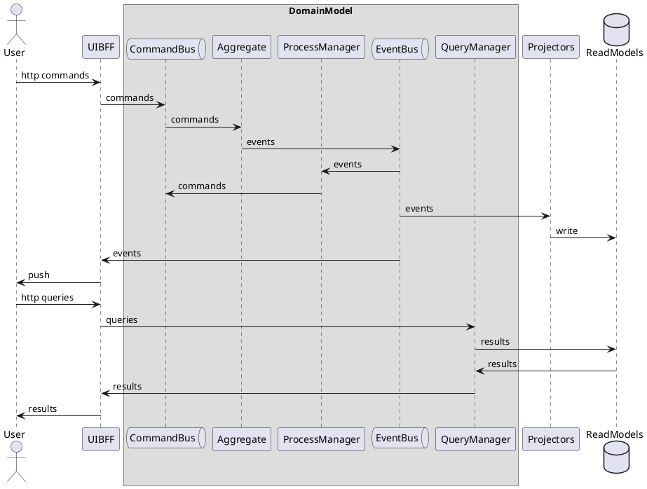
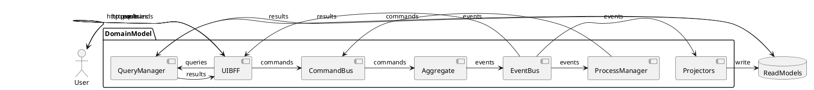

# Case E007

Diagram type: sequence · tier 3 · outcome: compiled low-structural
Image: `E007.png`

## Ground truth

## Answer (4 display-only lines removed; they are in `E007.stripped.txt`)

## Structural diff

Element F1 1.000 · Relationship F1 0.000

- nodes matched (9): `aggregate`, `commandbus`, `eventbus`, `processmanager`, `projectors`, `querymanager`, `readmodels`, `uibff`, `user`
- nodes missed (0): none
- nodes spurious (0): none
- edges matched (0): none
- edges missed (16): `aggregate -> eventbus : message`, `commandbus -> aggregate : message`, `eventbus -> processmanager : message`, `eventbus -> projectors : message`, `eventbus -> uibff : message`, `processmanager -> commandbus : message`, `projectors -> readmodels : message`, `querymanager -> readmodels : message`, `querymanager -> uibff : message`, `readmodels -> querymanager : message`, `uibff -> commandbus : message`, `uibff -> querymanager : message`, `uibff -> user : message` ×2, `user -> uibff : message` ×2
- edges spurious (16): `aggregate -> eventbus : association (one arrowhead)`, `commandbus -> aggregate : association (one arrowhead)`, `eventbus -> processmanager : association (one arrowhead)`, `eventbus -> projectors : association (one arrowhead)`, `eventbus -> uibff : association (one arrowhead)`, `processmanager -> commandbus : association (one arrowhead)`, `projectors -> readmodels : association (one arrowhead)`, `querymanager -> readmodels : association (one arrowhead)`, `querymanager -> uibff : association (one arrowhead)`, `readmodels -> querymanager : association (one arrowhead)`, `uibff -> commandbus : association (one arrowhead)`, `uibff -> querymanager : association (one arrowhead)`, `uibff -> user : association (one arrowhead)` ×2, `user -> uibff : association (one arrowhead)` ×2
