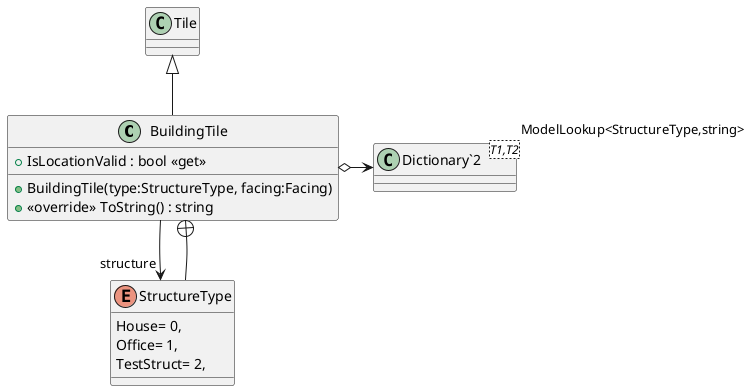

# Case E008

Diagram type: class · tier 2 · outcome: compile fail
Image: `E008.png`

## Ground truth



## Answer (32 display-only lines removed; they are in `E008.stripped.txt`)

```plantuml
@startuml

class Tile {
}

class BuildingTile {
  + IsLocationValid : bool «get»
  + BuildingTile(type:StructureType, facing:Facing)
  + «override» ToString() : string
}

class StructureType {
  House = 0,
  Office = 1,
  TestStruct = 2,
}

class Dictionary`2 {
}

Tile <|-- BuildingTile
BuildingTile --> StructureType : structure
BuildingTile o-- Dictionary`2
note right of Dictionary`2
  ModelLookup<StructureType,string>
  T1,T2
end note

@enduml
```

## Renderer

Renderer: error at line 55 of the answer block: `BuildingTile o-- Dictionary`2`
