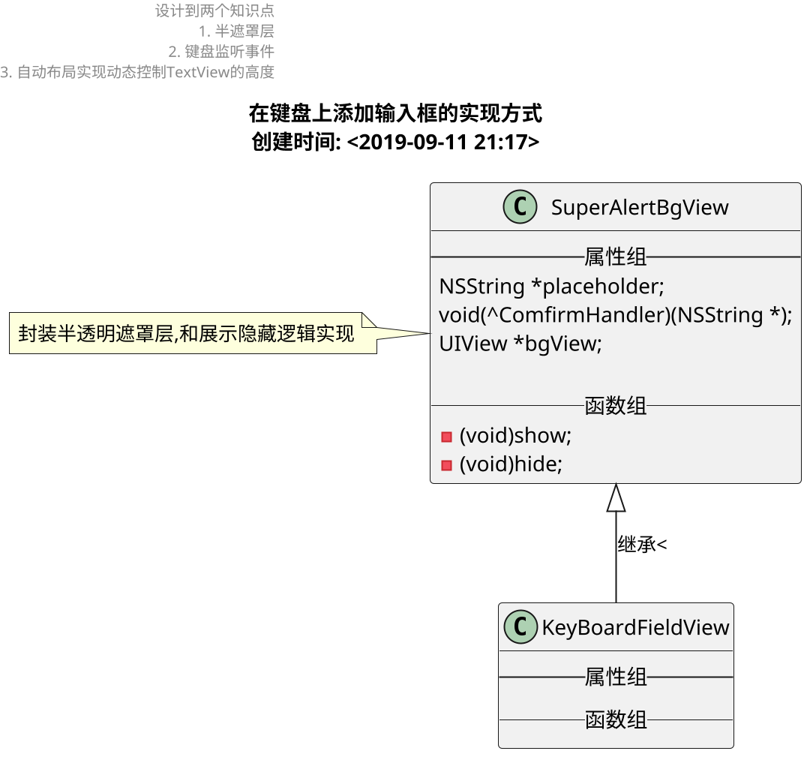
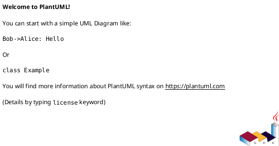

# Case E009

Diagram type: class · tier 3 · outcome: compile fail
Image: `E009.png`

## Ground truth

## Answer (489 display-only lines removed; they are in `E009.stripped.txt`)

## Renderer

The answer has no `@enduml`. Renderer: no PNG produced
