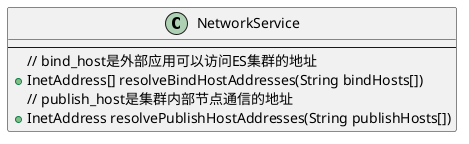
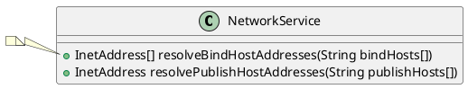
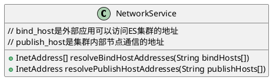

# Case E010

Diagram type: class · tier 1 · outcome: compiled low-structural
Image: `E010.png`

## Ground truth

## Answer (2 display-only lines removed; they are in `E010.stripped.txt`)

Wait, let me redo this more carefully.

## Structural diff

Element F1 0.667 · Relationship F1 0.000

- nodes matched (1): `networkservice`
- nodes missed (0): none
- nodes spurious (1): `networkservice$$$left`
- edges matched (0): none
- edges missed (0): none
- edges spurious (1): `networkservice -> networkservice$$$left : association`
