# Case E011

Diagram type: class · tier 4 · outcome: compile fail
Image: `E011.png`

## Ground truth

```plantuml
' Blob ID: dd18a88b118626df1c03faa29d229393627c778c
' Original Path: /7OPR2_KU1/src/cz/osu/student/R19584/Library.puml
' Source: World of Code

@startuml

title 'R19584 KU1 - Knihovna'

class Library {
    - books : ArrayList<Book>
    - persons : ArrayList<Person>
    - borrowings : ArrayList<Borrowing>
    - standardBorrowingPeriod : int

    + Library()

    + addBook(book : Book) : void
    + addPerson(person : Person) : void
    + addBorrowing(borrowing : Borrowing) : void

    + addBooks(books : ArrayList<Book>) : void
    + addPersons(persons : ArrayList<Person>) : void
    + addBorrowings(borrowings : ArrayList<Borrowing>) : void

    + getBooks() : ArrayList<Book>
    + getBookBorrowings(book: Book) : ArrayList<Borrowing>

    + getPersons() : ArrayList<Person>
    + getPersonBorrowings(person: Person) : ArrayList<Borrowing>
    + getPersonPenalties(person: Person) : ArrayList<Penalty>

    + penalisePerson(person : Person, penalty : Penalty) : void

    + getBorrowings() : ArrayList<Borrowing>
    + getAllBorrowingsThatAreOverdue() : ArrayList<Borrowing>

    + isBorrowingOverdue(borrowing : Borrowing) : boolean

    + extendBorrowing(borrowing : Borrowing) : void
    + returnBookAndEndBorrowing(borrowing : Borrowing) : void
    + borrowBookToPerson(person : Person, book : Book) : void

    + toString() : String
}

Library -o IDSingleton
Library -o Book
Library -o Borrowing
Library -o Person
Library -o DateTime

class IDSingleton {
    - instance : IDSingleton <<static>>
    - idCounter : int <<static>>

    - IDSingleton()

    + getInstance() : IDSingleton <<static>>

    + getId() : int
}

class Book {
    - author : Person
    - title : String
    - publisher : String
    - isbn : String

    + Book(author : Person, title : String, publisher : String, isbn : String)

    + getAuthor() : Person
    + getTitle() : String
    + getPublisher() : String
    + getISBN() : String

    + toString() : String
}

Book -o Person

class Borrowing {
    - id : int
    - book : Book
    - person : Person
    - borrowed_since : DateTime
    - borrowed_until : DateTime

    + Borrowing(id : int, book : Book, person : Person, borrowed_since : DateTime, borrowed_until : DateTime)

    + getId() : int
    + getBook() : Book
    + getPerson() : Person
    + getBorrowedSince() : DateTime
    + getBorrowedUntil() : DateTime

    + setBorrowedUntil() : void

    + toString() : String
}

Borrowing -o Person
Borrowing -o Book
Borrowing -o DateTime

class Person {
    - name : String
    - surname : String
    - phone_numbers : ArrayList<Integer>
    - emails : ArrayList<String>
    - penalties : ArrayList<Penalty>

    + Person(name : String, surname : String)

    + Person(name : String, surname : String, phone_number : int)
    + Person(name : String, surname : String, email: String)
    + Person(name : String, surname : String, phone_number : int, email: String)

    + getName() : String
    + getSurname() : String
    + getFullName() : String
    + getPhoneNumbers() : ArrayList<Integer>
    + getEmails() : ArrayList<String>
    + getPenalties() : ArrayList<Penalty>

    + setName(name : String) : void
    + setSurname(surname : String) : void
    + addPhoneNumber(phone_number : int) : void
    + addPhoneNumbers(phone_numbers : ArrayList<Integer>) : void
    + addEmail(email : String) : void
    + addEmails(emails : ArrayList<String>) : void
    + addPenalty(penalty : Penalty) : void

    + toString() : String
}

Person -o Penalty

class Penalty {
    - Description : String

    + Penalty(description : String)

    + getDescription() : String

    + toString() : String
}

class DateTime {
    - daysInMonths : int[]
    - day : int
    - month : EMoth
    - year : int
    - hour : int
    - minutes : int
    - seconds : int

    + DateTime(day : int, month : EMonth, year : int)
    + DateTime(day : int, month : int, year : int)
    + DateTime(day : int, month : EMonth, year : int, hours : int, minutes : int, seconds : int)
    + DateTime(day : int, month : int, year : int, hours : int, minutes : int, seconds : int)

    + getDay() : int
    + getMonth() : EMonth
    + getYear() : int
    + getHour() : int
    + getMinutes() : int
    + getSeconds() : int

    + setDay(day : int) : void
    + setMonth(month : EMonth) : void
    + setMonth(month : int) : void
    + setYear(year : int) : void
    + setHour(hour : int) : void
    + setMinutes(minutes : int) : void
    + setSeconds(seconds : int) : void

    + addDays(days : int) : void
    + getDateTimeInSecondsSince1970() : double

    + copy() : DateTime
    + toString() : String
}

DateTime -o EMonth

enum EMonth {
    + JANUARY
    + FEBRUARY
    + MARCH
    + APRIL
    + MAY
    + JUNE
    + JULY
    + AUGUST
    + SEPTEMBER
    + OCTOBER
    + NOVEMBER
    + DECEMBER

    + getIntFromEMonth(month : EMonth) : int <<static>>
    + getEMonthFromInt(month : int) : EMonth <<static>>
}

@enduml
```



## Answer (0 display-only lines removed; they are in `E011.stripped.txt`)

```plantuml

```

## Renderer

The answer has no `@enduml`. Renderer: no PNG produced
