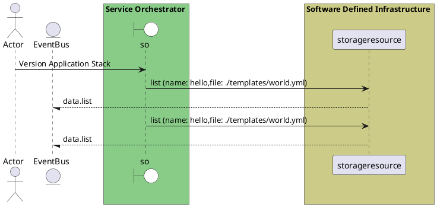
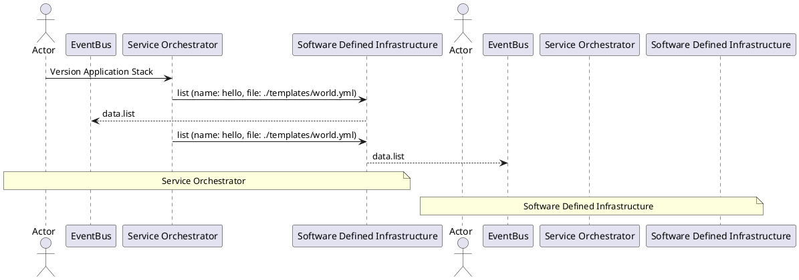

# Case E012

Diagram type: sequence · tier 2 · outcome: compiled low-structural
Image: `E012.png`

## Ground truth

## Answer (28 display-only lines removed; they are in `E012.stripped.txt`)

## Structural diff

Element F1 0.333 · Relationship F1 0.000

- nodes matched (2): `actor`, `eventbus`
- nodes missed (2): `so`, `storageresource`
- nodes spurious (6): `actor`, `eventbus`, `service orchestrator` ×2, `software defined infrastructure` ×2
- edges matched (0): none
- edges missed (5): `actor -> so : message`, `so -> storageresource : message` ×2, `storageresource -> eventbus : message` ×2
- edges spurious (5): `actor -> service orchestrator : message`, `service orchestrator -> software defined infrastructure : message` ×2, `software defined infrastructure -> eventbus : message` ×2
