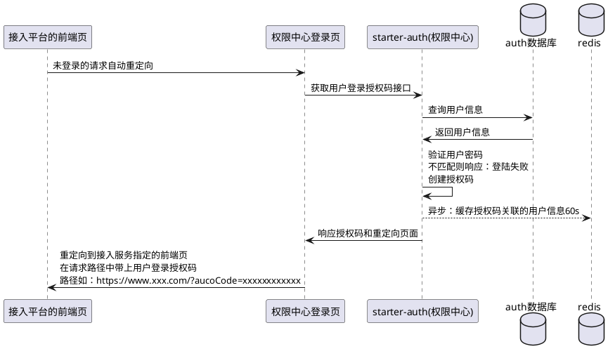

# Case E013

Diagram type: sequence · tier 3 · outcome: compile fail
Image: `E013.png`

## Ground truth



## Answer (7 display-only lines removed; they are in `E013.stripped.txt`)

```plantuml
@startuml

participant "接入平台的前端页" as FE
participant "权限中心登录页" as LOGIN
participant "starter-auth(权限中心)" as AUTH
database "auth数据库" as DB
database "redis" as REDIS

FE -> LOGIN : 未登录的请求自动重定向
LOGIN -> AUTH : 获取用户登录授权码接口
AUTH -> DB : 查询用户信息
DB --> AUTH : 返回用户信息

note right of AUTH
验证用户密码
不匹配则响应：登陆失败
创建授权码
end note

AUTH -> AUTH : 
AUTH ..> REDIS : 异步：缓存授权码关联的用户信息60s
AUTH --> LOGIN : 响应授权码和重定向页面

LOGIN --> FE : 重定向到接入服务指定的前端页\n在请求路径中带上用户登录授权码\n路径如： https://www.xxx.com/?aucoCode=xxxxxxxxxxxx

@enduml
```

## Renderer

Renderer: error at line 28 of the answer block: `AUTH ..> REDIS : 异步：缓存授权码关联的用户信息60s`
