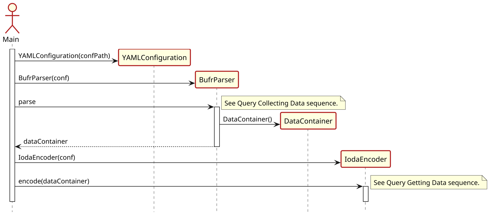

# Case E014

Diagram type: sequence · tier 3 · outcome: compile fail
Image: `E014.png`

## Ground truth



## Answer (0 display-only lines removed; they are in `E014.stripped.txt`)

```plantuml
@startuml
actor Main

Main -> "YAMLConfiguration" ** : YAMLConfiguration(confPath)
Main -> "BufrParser" ** : BufrParser(conf)
Main -> "BufrParser" : parse
note right : See Query Collecting Data sequence.
"BufrParser" -> "DataContainer" ** : DataContainer()
"BufrParser" ..> Main : dataContainer
Main -> "IodaEncoder" ** : IodaEncoder(conf)
Main -> "IodaEncoder" : encode(dataContainer)
note right : See Query Getting Data sequence.
@enduml
```

## Renderer

Renderer: error at line 9 of the answer block: `"BufrParser" ..> Main : dataContainer`
