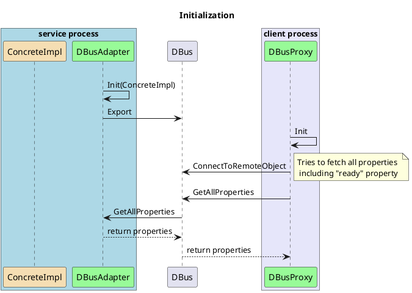

# Case E015

Diagram type: sequence · tier 2 · outcome: compile fail
Image: `E015.png`

## Ground truth



## Answer (1 display-only lines removed; they are in `E015.stripped.txt`)

```plantuml
@startuml
participant "service process" as SP {
    participant "ConcreteImpl" as CI
    participant "DBusAdapter" as DA
}
participant "DBus" as DB
participant "client process" as CP {
    participant "DBusProxy" as DP
}

DA -> DA: Init(ConcreteImpl)
DA -> DB: Export
DP -> DP: Init
DP -> DB: ConnectToRemoteObject
note right of DP: Tries to fetch all properties\nincluding "ready" property
DP -> DB: GetAllProperties
DB -> DA: GetAllProperties
DA --> DB: return properties
DB --> DP: return properties
@enduml
```

## Renderer

Renderer: error at line 3 of the answer block: `participant "service process" as SP {`
