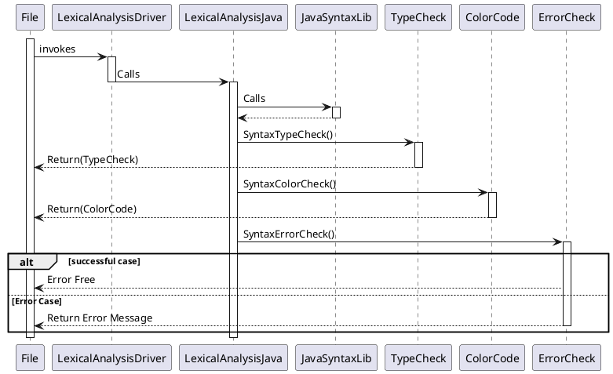
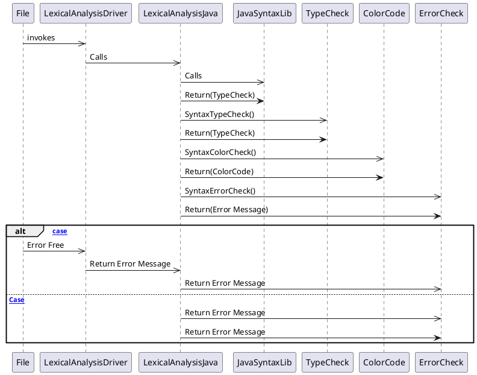

# Case E016

Diagram type: sequence · tier 3 · outcome: compiled low-structural
Image: `E016.png`

## Ground truth

## Answer (0 display-only lines removed; they are in `E016.stripped.txt`)

## Structural diff

Element F1 1.000 · Relationship F1 0.462

- nodes matched (7): `colorcode`, `errorcheck`, `file`, `javasyntaxlib`, `lexicalanalysisdriver`, `lexicalanalysisjava`, `typecheck`
- nodes missed (0): none
- nodes spurious (0): none
- edges matched (6): `file -> lexicalanalysisdriver : message`, `lexicalanalysisdriver -> lexicalanalysisjava : message`, `lexicalanalysisjava -> colorcode : message`, `lexicalanalysisjava -> errorcheck : message`, `lexicalanalysisjava -> javasyntaxlib : message`, `lexicalanalysisjava -> typecheck : message`
- edges missed (5): `colorcode -> file : message`, `errorcheck -> file : message` ×2, `javasyntaxlib -> lexicalanalysisjava : message`, `typecheck -> file : message`
- edges spurious (9): `file -> lexicalanalysisdriver : message`, `lexicalanalysisdriver -> lexicalanalysisjava : message`, `lexicalanalysisjava -> colorcode : message`, `lexicalanalysisjava -> errorcheck : message` ×4, `lexicalanalysisjava -> javasyntaxlib : message`, `lexicalanalysisjava -> typecheck : message`
