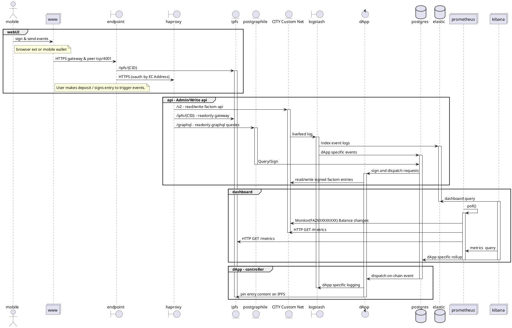

# Case E017

Diagram type: sequence · tier 4 · outcome: compile fail
Image: `E017.png`

## Ground truth



## Answer (6 display-only lines removed; they are in `E017.stripped.txt`)

```plantuml
@startuml

actor "mobile" as mobile
component "www" as www
participant "endpoint" as endpoint
participant "haproxy" as haproxy
participant "ipfs" as ipfs
participant "postgraphile" as postgraphile
participant "CITY Custom Net" as city
participant "logstash" as logstash
participant "dApp" as dapp
database "postgres" as postgres
database "elastic" as elastic
component "prometheus" as prometheus
component "kibana" as kibana

rectangle "webUI" {
  mobile -> www: sign & send events
  note right: browser ext or mobile wallet
  www -> endpoint: HTTPS gateway & peer tcp/4001
  endpoint -> ipfs: /ipfs/{CID}
  ipfs -> haproxy: HTTPS (oauth by EC Address)
  note right: User makes deposit / signs entry to trigger events.
}

rectangle "api - Admin/Write api" {
  haproxy -> endpoint: /v2 - read/write factom api
  haproxy -> ipfs: /ipfs/{CID} - readonly gateway
  haproxy -> postgraphile: /graphql - readonly graphql queries
  endpoint -> logstash: livefeed log
  logstash -> elastic: index event logs
  elastic -> postgres: dApp specific events
  postgraphile -> dapp: Query/Sign
  dapp -> postgres: sign and dispatch requests
  postgres -> haproxy: read/write signed factom entries
}

rectangle "dashboard" {
  kibana -> elastic: dashboard query
  kibana -> kibana: poll()
  kibana -> city: Monitor(FA2XXXXXXXX) Balance changes
  kibana -> prometheus: HTTP GET /metrics
  prometheus -> haproxy: HTTP GET /metrics
  prometheus -> kibana: metrics query
  kibana -> postgres: dApp specific rollup
}

rectangle "dApp - controller" {
  postgres -> dapp: dispatch on-chain event
  dapp -> logstash: dApp specific logging
  dapp -> ipfs: pin entry content on IPFS
}

@enduml
```

## Renderer

Renderer: error at line 11 of the answer block: `participant "endpoint" as endpoint`
