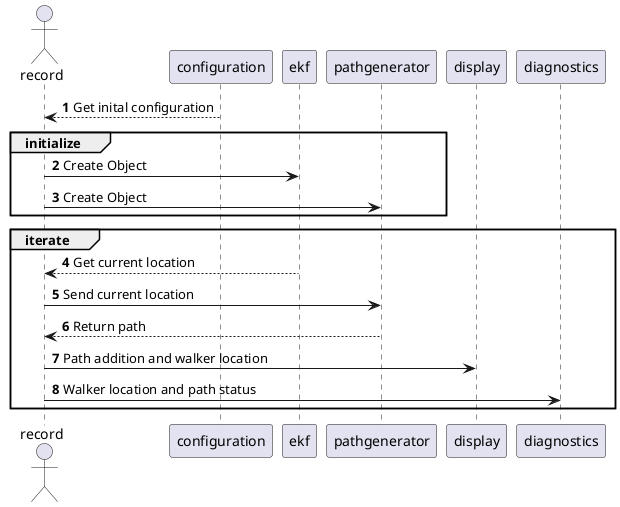
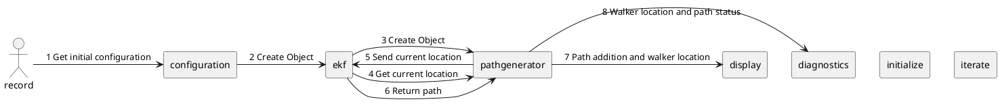

# Case E018

Diagram type: sequence · tier 2 · outcome: compiled low-structural
Image: `E018.png`

## Ground truth

## Answer (0 display-only lines removed; they are in `E018.stripped.txt`)

## Structural diff

Element F1 0.857 · Relationship F1 0.000

- nodes matched (6): `configuration`, `diagnostics`, `display`, `ekf`, `pathgenerator`, `record`
- nodes missed (0): none
- nodes spurious (2): `initialize`, `iterate`
- edges matched (0): none
- edges missed (8): `configuration -> record : message`, `ekf -> record : message`, `pathgenerator -> record : message`, `record -> diagnostics : message`, `record -> display : message`, `record -> ekf : message`, `record -> pathgenerator : message` ×2
- edges spurious (8): `configuration -> ekf : association (one arrowhead)`, `ekf -> pathgenerator : association (one arrowhead)` ×3, `pathgenerator -> diagnostics : association (one arrowhead)`, `pathgenerator -> display : association (one arrowhead)`, `pathgenerator -> ekf : association (one arrowhead)`, `record -> configuration : association (one arrowhead)`
