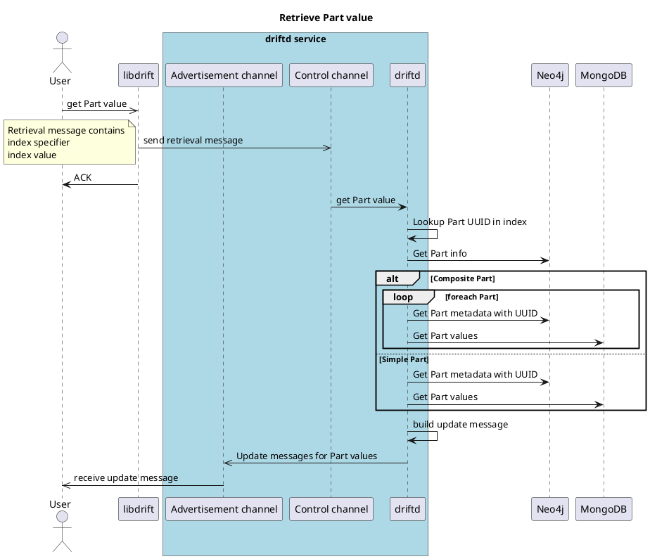
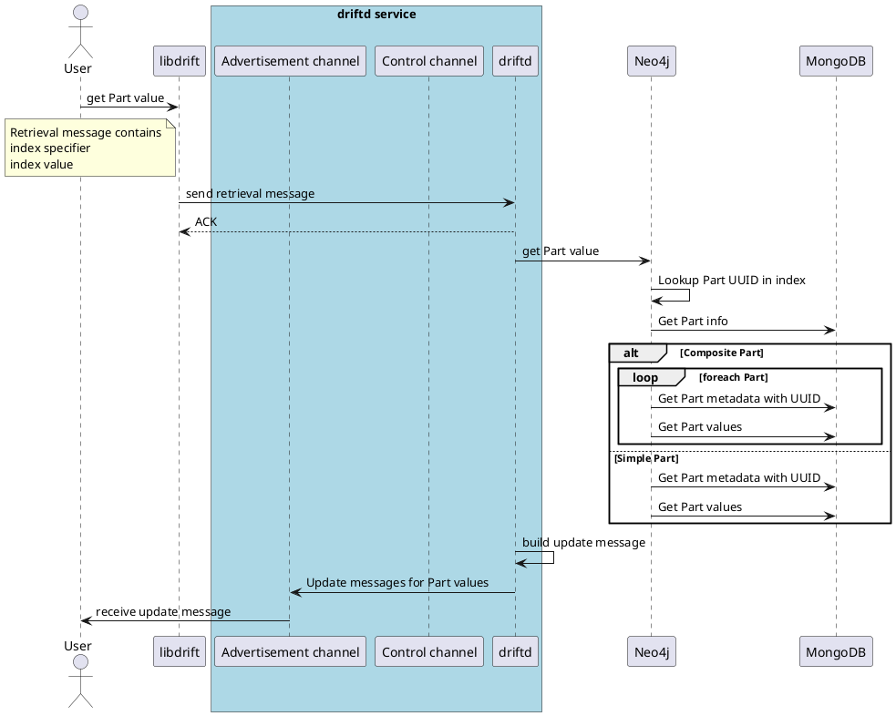

# Case E019

Diagram type: sequence · tier 3 · outcome: compiled low-structural
Image: `E019.png`

## Ground truth

## Answer (1 display-only lines removed; they are in `E019.stripped.txt`)

## Structural diff

Element F1 1.000 · Relationship F1 0.385

- nodes matched (7): `advertisement channel`, `control channel`, `driftd`, `libdrift`, `mongodb`, `neo4j`, `user`
- nodes missed (0): none
- nodes spurious (0): none
- edges matched (5): `advertisement channel -> user : message`, `driftd -> advertisement channel : message`, `driftd -> driftd : message`, `driftd -> neo4j : message`, `user -> libdrift : message`
- edges missed (8): `control channel -> driftd : message`, `driftd -> driftd : message`, `driftd -> mongodb : message` ×2, `driftd -> neo4j : message` ×2, `libdrift -> control channel : message`, `libdrift -> user : message`
- edges spurious (8): `driftd -> libdrift : message`, `libdrift -> driftd : message`, `neo4j -> mongodb : message` ×5, `neo4j -> neo4j : message`
