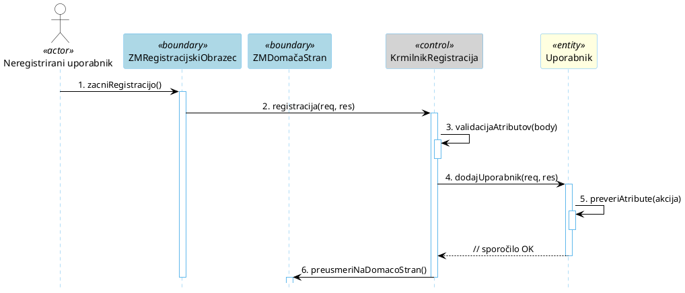
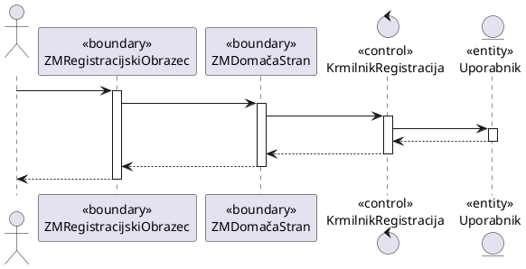

# Case E020

Diagram type: sequence · tier 3 · outcome: compiled low-structural
Image: `E020.png`

## Ground truth

## Answer (16 display-only lines removed; they are in `E020.stripped.txt`)

## Structural diff

Element F1 0.800 · Relationship F1 0.400

- nodes matched (4): `krmilnikregistracija`, `uporabnik`, `zmdoma?astran`, `zmregistracijskiobrazec`
- nodes missed (1): `neregistrirani uporabnik`
- nodes spurious (1): `a`
- edges matched (3): `krmilnikregistracija -> uporabnik : message`, `krmilnikregistracija -> zmdoma?astran : message`, `uporabnik -> krmilnikregistracija : message`
- edges missed (4): `krmilnikregistracija -> krmilnikregistracija : message`, `neregistrirani uporabnik -> zmregistracijskiobrazec : message`, `uporabnik -> uporabnik : message`, `zmregistracijskiobrazec -> krmilnikregistracija : message`
- edges spurious (5): `a -> zmregistracijskiobrazec : message`, `zmdoma?astran -> krmilnikregistracija : message`, `zmdoma?astran -> zmregistracijskiobrazec : message`, `zmregistracijskiobrazec -> a : message`, `zmregistracijskiobrazec -> zmdoma?astran : message`
