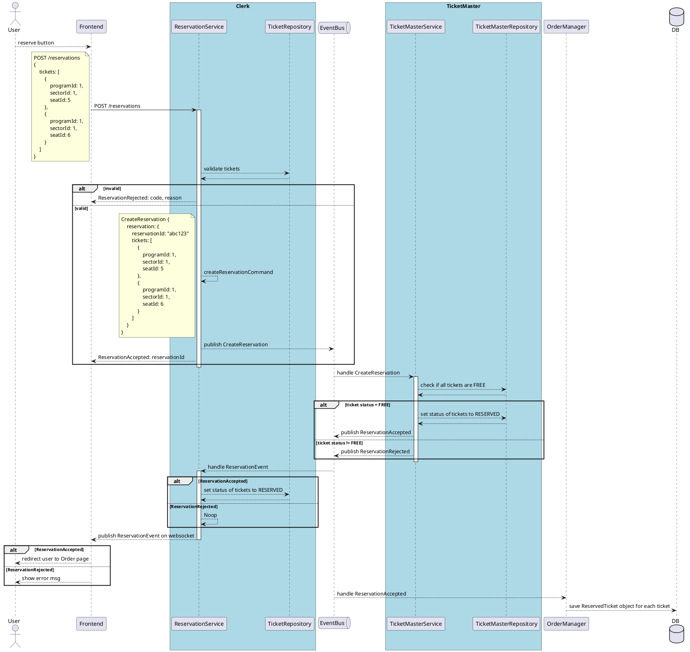

# Case E021

Diagram type: sequence · tier 4 · outcome: compile fail
Image: `E021.png`

## Ground truth



## Answer (0 display-only lines removed; they are in `E021.stripped.txt`)

```plantuml
@startuml

actor User
participant Frontend
box "Clerk" #LightCyan
participant ReservationService
participant TicketRepository
end box
participant EventBus
box "TicketMaster" #LightCyan
participant TicketMasterService
participant TicketMasterRepository
end box
participant OrderManager
database DB

User -> Frontend : reserve button

note left of Frontend
POST /reservations
{
  tickets: [
    {
      programId: 1,
      sectorId: 1,
      seatId: 5
    },
    {
      programId: 1,
      sectorId: 1,
      seatId: 6
    }
  ]
}
end note

Frontend -> ReservationService : POST /reservations

ReservationService -> TicketRepository : validate tickets

alt [invalid]
ReservationService <-- TicketRepository
Frontend <-- ReservationService : ReservationRejected: code, reason
else [valid]

note left of ReservationService #LightYellow
CreateReservation {
  reservation: {
    reservationId: "abc123"
    tickets: [
      {
        programId: 1,
        sectorId: 1,
        seatId: 5
      },
      {
        programId: 1,
        sectorId: 1,
        seatId: 6
      }
    ]
  }
}
end note

ReservationService <.. TicketRepository : createReservationCommand

ReservationService -> EventBus : publish CreateReservation

Frontend <-- ReservationService : ReservationAccepted: reservationId

end

EventBus -> TicketMasterService : handle CreateReservation

TicketMasterService -> TicketMasterRepository : check if all tickets are FREE

alt [ticket status = FREE]
TicketMasterService <-- TicketMasterRepository : set status of tickets to RESERVED
TicketMasterService -> EventBus : publish ReservationAccepted
else [ticket status != FREE]
TicketMasterService -> EventBus : publish ReservationRejected
end

EventBus -> ReservationService : handle ReservationEvent

alt [ReservationAccepted]
ReservationService ..> TicketRepository : set status of tickets to RESERVED
else [ReservationRejected]
ReservationService ..> TicketRepository : Noop
end

ReservationService -> Frontend : publish ReservationEvent on websocket

alt [ReservationAccepted]
Frontend -> User : redirect user to Order page
else [ReservationRejected]
Frontend -> User : show error msg
end

EventBus -> OrderManager : handle ReservationAccepted
OrderManager -> DB : save ReservedTicket object for each ticket

@enduml
```

## Renderer

Renderer: error at line 66 of the answer block: `ReservationService <.. TicketRepository : createReservationCommand`
