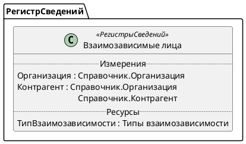

# Case E022

Diagram type: class · tier 1 · outcome: compile fail
Image: `E022.png`

## Ground truth



## Answer (1 display-only lines removed; they are in `E022.stripped.txt`)

```plantuml
@startuml
package "РегистрСведений" {
    package "«РегистрыСведений»\nВзаимозависимые лица" as "Взаимозависимые лица" {
        [C]
        ..Измерения..
        Организация : Справочник.Организация
        Контрагент : Справочник.Организация\nСправочник.Контрагент
        ..Ресурсы..
        ТипВзаимозависимости : Типы взаимозависимости
    }
}
@enduml
```

## Renderer

Renderer: error at line 5 of the answer block: `[C]`
