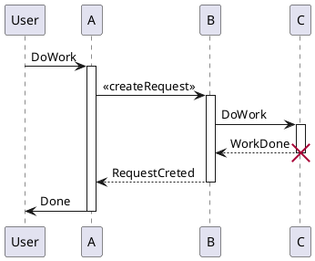
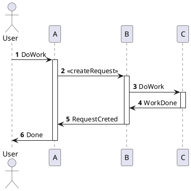

# Case E023

Diagram type: sequence · tier 2 · outcome: compile fail
Image: `E023.png`

## Ground truth

## Answer (2 display-only lines removed; they are in `E023.stripped.txt`)

## Renderer

Renderer: error at line 3 of the answer block: `left to right direction`
