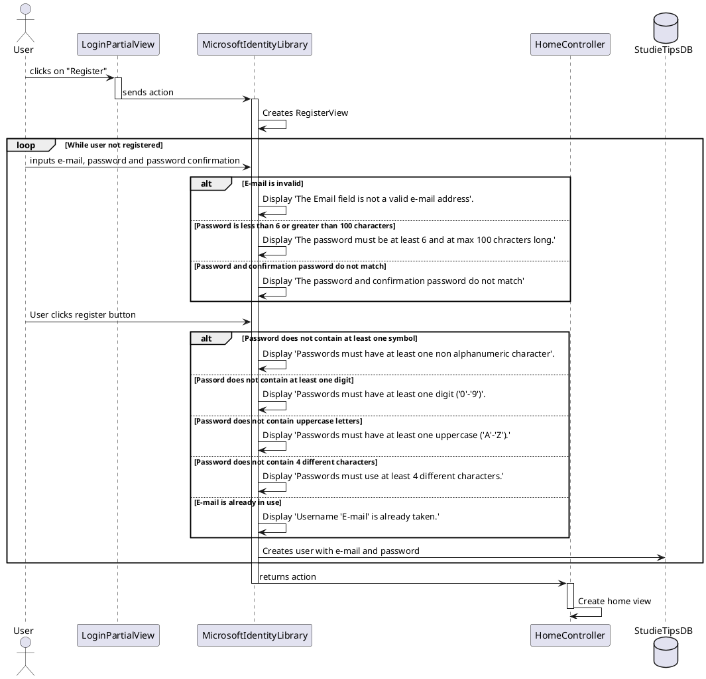

# Case E024

Diagram type: sequence · tier 3 · outcome: compile fail
Image: `E024.png`

## Ground truth



## Answer (0 display-only lines removed; they are in `E024.stripped.txt`)

```plantuml
@startuml
actor "User" as User
rectangle "LoginPartialView" as LoginPartialView
rectangle "MicrosoftIdentityLibrary" as MicrosoftIdentityLibrary
rectangle "HomeController" as HomeController
database "StudieTipsDB" as StudieTipsDB

User -> LoginPartialView: clicks on "Register"
activate LoginPartialView
LoginPartialView -> MicrosoftIdentityLibrary: sends action
activate MicrosoftIdentityLibrary
MicrosoftIdentityLibrary -> MicrosoftIdentityLibrary: Creates RegisterView
deactivate MicrosoftIdentityLibrary

loop While user not registered
    User -> MicrosoftIdentityLibrary: inputs e-mail, password and password confirmation
    alt E-mail is invalid
        MicrosoftIdentityLibrary -> MicrosoftIdentityLibrary: Display 'The Email field is not a valid e-mail address'.
    else Password is less than 6 or greater than 100 characters
        MicrosoftIdentityLibrary -> MicrosoftIdentityLibrary: Display 'The password must be at least 6 and at max 100 chracters long.'
    else Password and confirmation password do not match
        MicrosoftIdentityLibrary -> MicrosoftIdentityLibrary: Display 'The password and confirmation password do not match'
    end

    User -> MicrosoftIdentityLibrary: User clicks register button
    alt Password does not contain at least one symbol
        MicrosoftIdentityLibrary -> MicrosoftIdentityLibrary: Display 'Passwords must have at least one non alphanumeric character'.
    else Password does not contain at least one digit
        MicrosoftIdentityLibrary -> MicrosoftIdentityLibrary: Display 'Passwords must have at least one digit ('0'-'9').'
    else Password does not contain uppercase letters
        MicrosoftIdentityLibrary -> MicrosoftIdentityLibrary: Display 'Passwords must have at least one uppercase ('A'-'Z').'
    else Password does not contain 4 different characters
        MicrosoftIdentityLibrary -> MicrosoftIdentityLibrary: Display 'Passwords must use at least 4 different characters.'
    else E-mail is already in use
        MicrosoftIdentityLibrary -> MicrosoftIdentityLibrary: Display 'Username 'E-mail' is already taken.'
    else
        MicrosoftIdentityLibrary -> StudieTipsDB: Creates user with e-mail and password
    end
end

MicrosoftIdentityLibrary -> HomeController: returns action
deactivate MicrosoftIdentityLibrary
deactivate LoginPartialView
activate HomeController
HomeController -> HomeController: Create home view
deactivate HomeController

@enduml
```

## Renderer

Renderer: error at line 9 of the answer block: `activate LoginPartialView`
