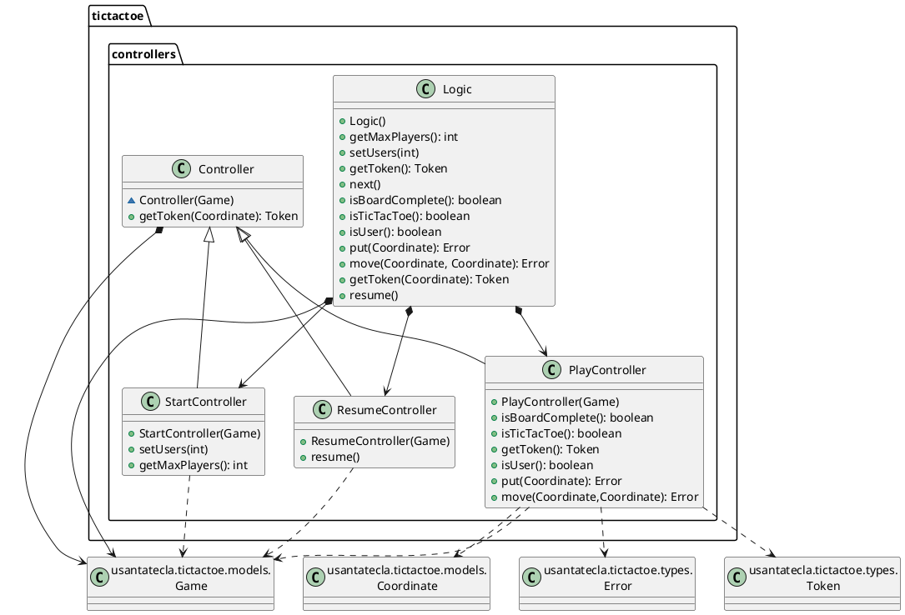
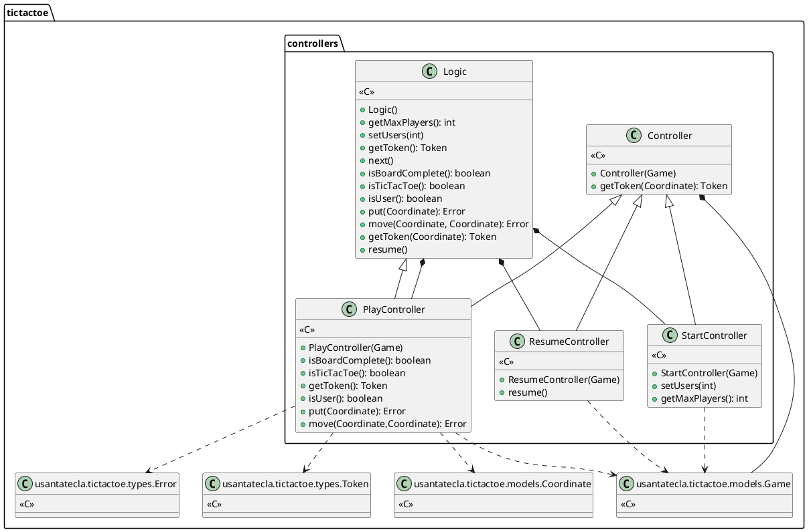

# Case E025

Diagram type: class · tier 4 · outcome: compiled low-structural
Image: `E025.png`

## Ground truth

## Answer (11 display-only lines removed; they are in `E025.stripped.txt`)

## Structural diff

Element F1 0.556 · Relationship F1 0.429

- nodes matched (5): `controller`, `logic`, `playcontroller`, `resumecontroller`, `startcontroller`
- nodes missed (4): `usantatecla.tictactoe.models. coordinate`, `usantatecla.tictactoe.models. game`, `usantatecla.tictactoe.types. error`, `usantatecla.tictactoe.types. token`
- nodes spurious (4): `usantatecla.tictactoe.models.coordinate`, `usantatecla.tictactoe.models.game`, `usantatecla.tictactoe.types.error`, `usantatecla.tictactoe.types.token`
- edges matched (6): `logic -> playcontroller : composition`, `logic -> resumecontroller : composition`, `logic -> startcontroller : composition`, `playcontroller -> controller : inheritance`, `resumecontroller -> controller : inheritance`, `startcontroller -> controller : inheritance`
- edges missed (8): `controller -> usantatecla.tictactoe.models. game : composition`, `logic -> usantatecla.tictactoe.models. game : composition`, `playcontroller -> usantatecla.tictactoe.models. coordinate : dependency`, `playcontroller -> usantatecla.tictactoe.models. game : dependency`, `playcontroller -> usantatecla.tictactoe.types. error : dependency`, `playcontroller -> usantatecla.tictactoe.types. token : dependency`, `resumecontroller -> usantatecla.tictactoe.models. game : dependency`, `startcontroller -> usantatecla.tictactoe.models. game : dependency`
- edges spurious (8): `controller -> usantatecla.tictactoe.models.game : composition`, `playcontroller -> logic : inheritance`, `playcontroller -> usantatecla.tictactoe.models.coordinate : dependency`, `playcontroller -> usantatecla.tictactoe.models.game : dependency`, `playcontroller -> usantatecla.tictactoe.types.error : dependency`, `playcontroller -> usantatecla.tictactoe.types.token : dependency`, `resumecontroller -> usantatecla.tictactoe.models.game : dependency`, `startcontroller -> usantatecla.tictactoe.models.game : dependency`
