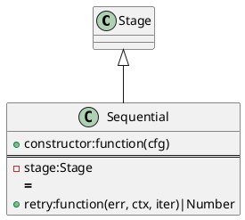

# Case E026

Diagram type: class · tier 1 · outcome: compile fail
Image: `E026.png`

## Ground truth

## Answer (110 display-only lines removed; they are in `E026.stripped.txt`)

## Renderer

The answer has no `@enduml`. Renderer: no PNG produced
