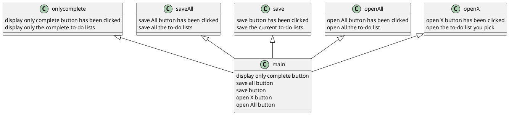
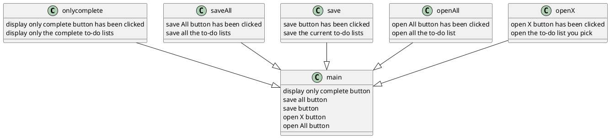

# Case E027

Diagram type: class · tier 3 · outcome: compiled low-structural
Image: `E027.png`

## Ground truth

## Answer (79 display-only lines removed; they are in `E027.stripped.txt`)

## Structural diff

Element F1 1.000 · Relationship F1 0.000

- nodes matched (6): `main`, `onlycomplete`, `openall`, `openx`, `save`, `saveall`
- nodes missed (0): none
- nodes spurious (0): none
- edges matched (0): none
- edges missed (5): `main -> onlycomplete : inheritance`, `main -> openall : inheritance`, `main -> openx : inheritance`, `main -> save : inheritance`, `main -> saveall : inheritance`
- edges spurious (5): `onlycomplete -> main : inheritance`, `openall -> main : inheritance`, `openx -> main : inheritance`, `save -> main : inheritance`, `saveall -> main : inheritance`
