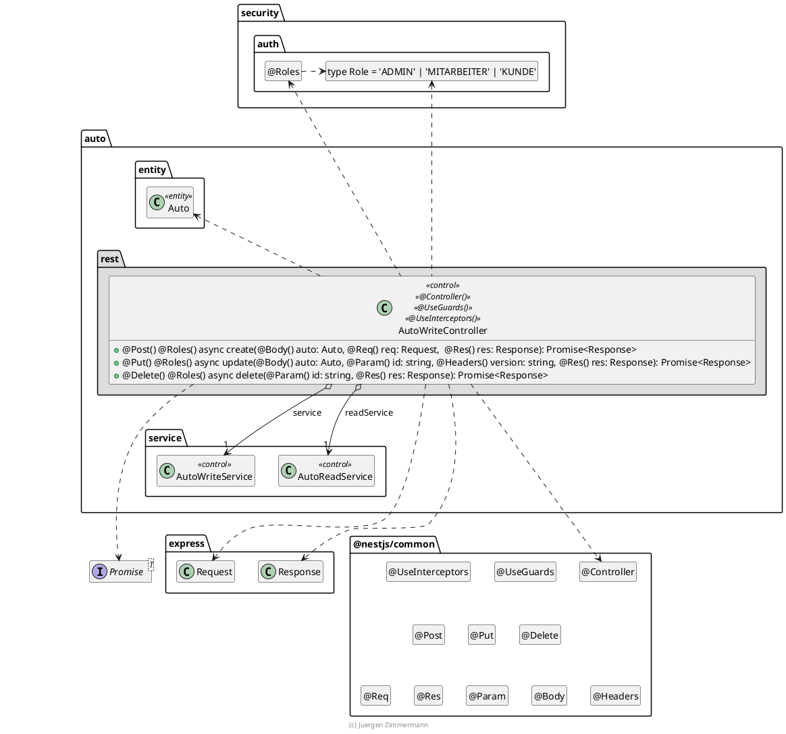

# Case E028

Diagram type: class · tier 4 · outcome: compiled low-structural
Image: `E028.png`

## Ground truth

## Answer (17 display-only lines removed; they are in `E028.stripped.txt`)

```plantuml
@startuml




package "security" as pkg_security {
  package "auth" as pkg_auth {
    class "@Roles" as Roles <<annotation>> #F5F5F5
    class "type Role = 'ADMIN' | 'MITARBEITER' | 'KUNDE'" as RoleType #F5F5F5
    Roles --> RoleType
  }
}

package "auto" as pkg_auto {

  package "entity" as pkg_entity {
    class "Auto" as AutoEntity <<entity>>
  }

  package "rest" as pkg_rest #DDDDDD {
    class "AutoWriteController" as AutoWriteController <<control>> {
      {method} @Post() @Roles() async create(@Body() auto: Auto, @Req() req: Request, @Res() res: Response): Promise<Response>
      {method} @Put() @Roles() async update(@Body() auto: Auto, @Param() id: string, @Headers() version: string, @Res() res: Response): Promise<Response>
      {method} @Delete() @Roles() async delete(@Param() id: string, @Res() res: Response): Promise<Response>
    }
    note top of AutoWriteController
      <<Controller()>>
      <<@UseGuards()>>
      <<@UseInterceptors()>>
    end note
  }

  package "service" as pkg_service {
    class "AutoWriteService" as AutoWriteService <<control>>
    class "AutoReadService" as AutoReadService <<control>>
  }
}

package "express" as pkg_express {
  class "Request" as ExpressRequest
  class "Response" as ExpressResponse
}

package "@nestjs/common" as pkg_nest {
  class "@Controller" as NestController <<annotation>> #F5F5F5
  class "@UseGuards" as NestUseGuards <<annotation>> #F5F5F5
  class "@UseInterceptors" as NestUseInterceptors <<annotation>> #F5F5F5

  class "@Post" as NestPost <<annotation>> #F5F5F5
  class "@Put" as NestPut <<annotation>> #F5F5F5
  class "@Delete" as NestDelete <<annotation>> #F5F5F5

  class "@Req" as NestReq <<annotation>> #F5F5F5
  class "@Res" as NestRes <<annotation>> #F5F5F5
  class "@Param" as NestParam <<annotation>> #F5F5F5
  class "@Body" as NestBody <<annotation>> #F5F5F5
  class "@Headers" as NestHeaders <<annotation>> #F5F5F5
}

interface "Promise" as PromiseI

AutoWriteController --> AutoWriteService : service
AutoWriteController --> AutoReadService : readService

AutoWriteController ..> AutoEntity
AutoWriteController ..> ExpressRequest
AutoWriteController ..> ExpressResponse
AutoWriteController ..> PromiseI

AutoWriteController ..> Roles
AutoWriteController ..> RoleType

AutoWriteController ..> NestController
AutoWriteController ..> NestUseGuards
AutoWriteController ..> NestUseInterceptors
AutoWriteController ..> NestPost
AutoWriteController ..> NestPut
AutoWriteController ..> NestDelete
AutoWriteController ..> NestReq
AutoWriteController ..> NestRes
AutoWriteController ..> NestParam
AutoWriteController ..> NestBody
AutoWriteController ..> NestHeaders

@enduml
```

## Structural diff

Element F1 0.976 · Relationship F1 0.452

- nodes matched (20): `@body`, `@controller`, `@delete`, `@headers`, `@param`, `@post`, `@put`, `@req`, `@res`, `@roles`, `@useguards`, `@useinterceptors`, `auto`, `autoreadservice`, `autowritecontroller`, `autowriteservice`, `promise`, `request`, `response`, `type role = 'admin' | 'mitarbeiter' | 'kunde'`
- nodes missed (0): none
- nodes spurious (1): ``
- edges matched (7): `autowritecontroller -> @controller : dependency`, `autowritecontroller -> @roles : dependency`, `autowritecontroller -> auto : dependency`, `autowritecontroller -> promise : dependency`, `autowritecontroller -> request : dependency`, `autowritecontroller -> response : dependency`, `autowritecontroller -> type role = 'admin' | 'mitarbeiter' | 'kunde' : dependency`
- edges missed (3): `@roles -> type role = 'admin' | 'mitarbeiter' | 'kunde' : dependency`, `autowritecontroller -> autoreadservice : aggregation`, `autowritecontroller -> autowriteservice : aggregation`
- edges spurious (14): ` -> autowritecontroller : dependency`, `@roles -> type role = 'admin' | 'mitarbeiter' | 'kunde' : association (one arrowhead)`, `autowritecontroller -> @body : dependency`, `autowritecontroller -> @delete : dependency`, `autowritecontroller -> @headers : dependency`, `autowritecontroller -> @param : dependency`, `autowritecontroller -> @post : dependency`, `autowritecontroller -> @put : dependency`, `autowritecontroller -> @req : dependency`, `autowritecontroller -> @res : dependency`, `autowritecontroller -> @useguards : dependency`, `autowritecontroller -> @useinterceptors : dependency`, `autowritecontroller -> autoreadservice : association (one arrowhead)`, `autowritecontroller -> autowriteservice : association (one arrowhead)`
