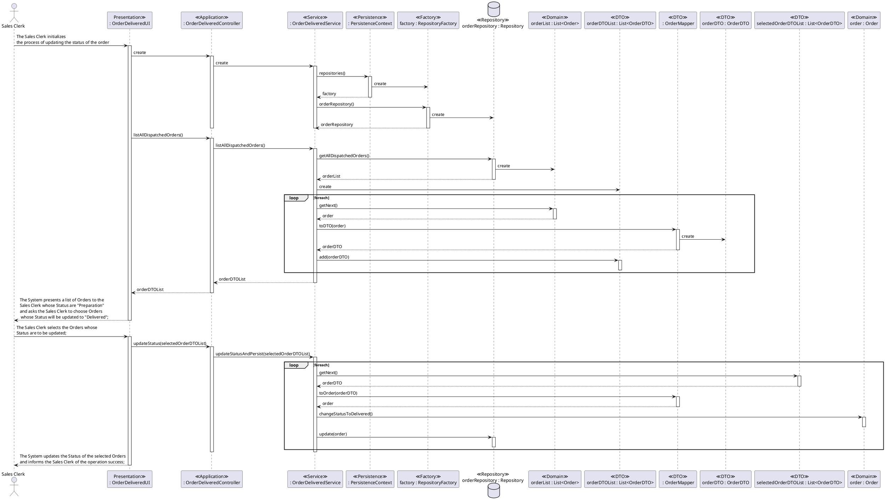

# Case E029

Diagram type: sequence · tier 4 · outcome: compile fail
Image: `E029.png`

## Ground truth



## Answer (13 display-only lines removed; they are in `E029.stripped.txt`)

```plantuml
@startuml

actor "Sales Clerk" as SalesClerk

participant "Presentation>>\n: OrderDeliveredUI" as UI
participant "«Application»\n: OrderDeliveredController" as Controller
participant "«Service»\n: OrderDeliveredService" as Service
participant "«Persistence»\n: PersistenceContext" as PC
participant "«Factory»\nfactory : RepositoryFactory" as RF
database "«Repository»\norderRepository : Repository" as Repo
participant "«Domain»\norderList : List<Order>" as OrderList
participant "«DTO»\norderDTOList : List<OrderDTO>" as OrderDTOList
participant "«DTO»\n: OrderMapper" as Mapper
participant "«DTO»\norderDTO : OrderDTO" as OrderDTO
participant "«DTO»\nselectedOrderDTOList : List<OrderDTO>" as SelectedOrderDTOList
participant "«Domain»\norder : Order" as Order

note left of SalesClerk
The Sales Clerk initializes
the process of updating the status of the order
end note

create UI
SalesClerk -> UI : create
activate UI

create Controller
UI -> Controller : create
activate Controller

create Service
Controller -> Service : create
activate Service

Service -> PC : repositories()
activate PC
PC --> Service : factory
deactivate PC

create RF
Service -> RF : create
activate RF

Service -> RF : orderRepository()
RF --> Service : orderRepository

create Repo
Service -> Repo : create
activate Repo

UI -> Controller : listAllDispatchedOrders()
Controller -> Service : listAllDispatchedOrders()
Service -> Repo : getAllDispatchedOrders()
create OrderList
Repo --> Service : orderList

create OrderDTOList
Service -> OrderDTOList : create

loop foreach
  Service -> OrderList : getNext()
  OrderList --> Service : order
  Service -> Mapper : toDTO(order)
  create OrderDTO
  Mapper --> Service : orderDTO
  Service -> OrderDTOList : add(orderDTO)
end

Service --> Controller : orderDTOList
Controller --> UI : orderDTOList

note left of SalesClerk
The System presents a list of Orders to the
Sales Clerk whose Status are "Preparation"
and asks the Sales Clerk to choose Orders
whose Status will be updated to "Delivered".
end note

note left of SalesClerk
The Sales Clerk selects the Orders whose
Status are to be updated.
end note

UI -> Controller : updateStatus(selectedOrderDTOList)
Controller -> Service : updateStatusAndPersist(selectedOrderDTOList)

loop foreach
  Service -> SelectedOrderDTOList : getNext()
  SelectedOrderDTOList --> Service : orderDTO
  Service -> Mapper : toOrder(orderDTO)
  Mapper --> Service : order
  Service -> Order : changeStatusToDelivered()
  Service -> Repo : update(order)
end

note left of SalesClerk
The System updates the Status of the selected Orders
and informs the Sales Clerk of the operation success.
end note

deactivate Repo
deactivate RF
deactivate Service
deactivate Controller
deactivate UI
@enduml
```

## Renderer

Renderer: error at line 68 of the answer block: `Repo --> Service : orderList`
