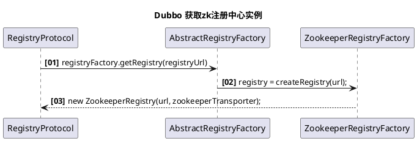

# Case E030

Diagram type: sequence · tier 1 · outcome: compile fail
Image: `E030.png`

## Ground truth

## Answer (532 display-only lines removed; they are in `E030.stripped.txt`)

## Renderer

The answer has no `@enduml`. Renderer: no PNG produced
