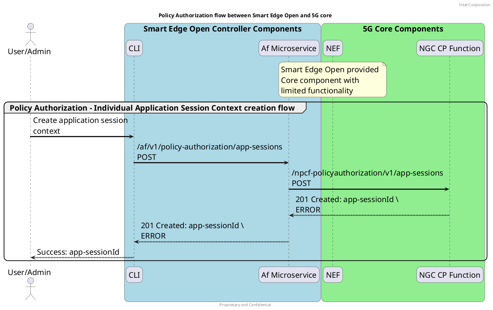
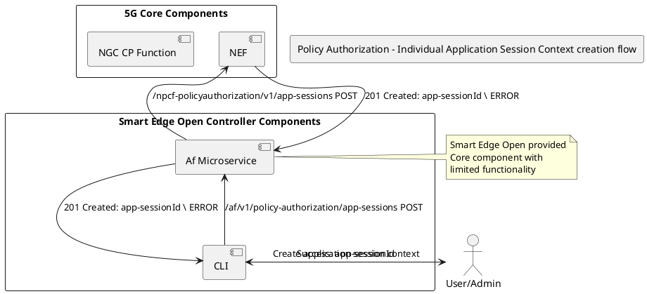

# Case E031

Diagram type: sequence · tier 3 · outcome: compiled low-structural
Image: `E031.png`

## Ground truth

## Answer (1 display-only lines removed; they are in `E031.stripped.txt`)

## Structural diff

Element F1 0.833 · Relationship F1 0.000

- nodes matched (5): `af microservice`, `cli`, `nef`, `ngc cp function`, `user/admin`
- nodes missed (0): none
- nodes spurious (2): `policy authorization - individual application session context creation flow`, `smart edge open provided core component with limited functionality`
- edges matched (0): none
- edges missed (6): `af microservice -> cli : message`, `af microservice -> ngc cp function : message`, `cli -> af microservice : message`, `cli -> user/admin : message`, `ngc cp function -> af microservice : message`, `user/admin -> cli : message`
- edges spurious (7): `af microservice -> cli : association (one arrowhead)`, `af microservice -> nef : association (one arrowhead)`, `af microservice -> smart edge open provided core component with limited functionality : dependency`, `cli -> af microservice : association (one arrowhead)`, `cli -> user/admin : association (one arrowhead)`, `nef -> af microservice : association (one arrowhead)`, `user/admin -> cli : association (one arrowhead)`
