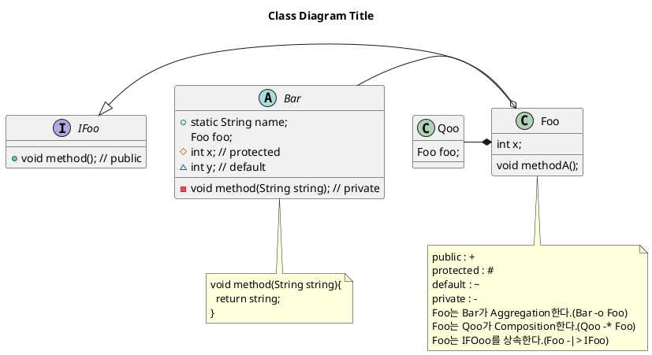
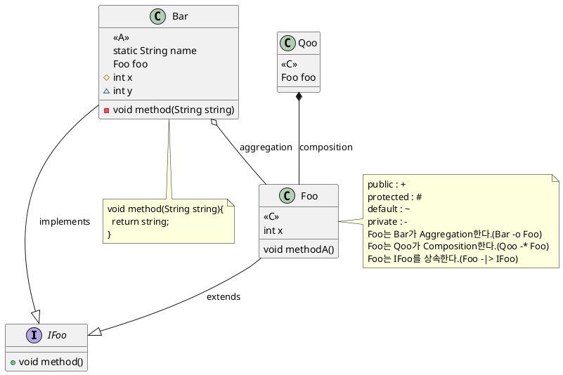

# Case E032

Diagram type: class · tier 3 · outcome: compiled low-structural
Image: `E032.png`

## Ground truth

## Answer (1 display-only lines removed; they are in `E032.stripped.txt`)

## Structural diff

Element F1 0.833 · Relationship F1 0.364

- nodes matched (5): `bar`, `foo`, `ifoo`, `qoo`, `void method(string string){ return string; }`
- nodes missed (1): `public : + protected : # default : ~ private : - foo? bar? aggregation??.(bar -o foo) foo? qoo? composition??.(qoo -* foo) foo? ifooo? ????.(foo -|> ifoo)`
- nodes spurious (1): `public : + protected : # default : ~ private : - foo? bar? aggregation??.(bar -o foo) foo? qoo? composition??.(qoo -* foo) foo? ifoo? ????.(foo -|> ifoo)`
- edges matched (2): `bar -> void method(string string){ return string; } : dependency`, `foo -> ifoo : inheritance`
- edges missed (3): `foo -> bar : aggregation`, `foo -> public : + protected : # default : ~ private : - foo? bar? aggregation??.(bar -o foo) foo? qoo? composition??.(qoo -* foo) foo? ifooo? ????.(foo -|> ifoo) : dependency`, `foo -> qoo : composition`
- edges spurious (4): `bar -> foo : aggregation`, `bar -> ifoo : inheritance`, `foo -> public : + protected : # default : ~ private : - foo? bar? aggregation??.(bar -o foo) foo? qoo? composition??.(qoo -* foo) foo? ifoo? ????.(foo -|> ifoo) : dependency`, `qoo -> foo : composition`
