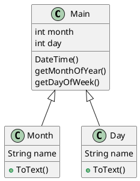

# Case E033

Diagram type: class · tier 2 · outcome: compiled low-structural
Image: `E033.png`

## Ground truth

## Answer (1 display-only lines removed; they are in `E033.stripped.txt`)

## Structural diff

Element F1 1.000 · Relationship F1 0.000

- nodes matched (3): `day`, `main`, `month`
- nodes missed (0): none
- nodes spurious (0): none
- edges matched (0): none
- edges missed (2): `day -> main : association (one arrowhead)`, `month -> main : association (one arrowhead)`
- edges spurious (2): `day -> main : inheritance`, `month -> main : inheritance`
