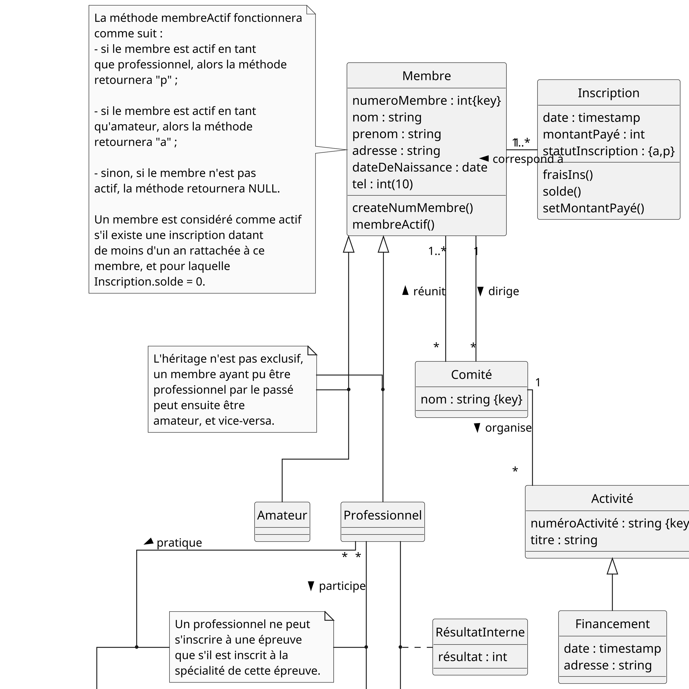

# Case E034

Diagram type: class · tier 4 · outcome: compile fail
Image: `E034.png`

## Ground truth



## Answer (0 display-only lines removed; they are in `E034.stripped.txt`)

```plantuml
@startuml

note "Sauf indication contraire, les héritages de cette MLD sont exclusifs, et les attributs doivent tous être non nuls." as Note1

class Membre {
    numeroMembre : int{key}
    nom : string
    prenom : string
    adresse : string
    dateDeNaissance : date
    tel : int(10)
    --
    createNumMembre()
    membreActif()
}

class Inscription {
    date : timestamp
    montantPayé : int
    statutInscription : {a,p}
    --
    fraisIns()
    solde()
    setMontantPayé()
}

class Comité {
    nom : string {key}
}

class Activité {
    numéroActivité : string {key}
    titre : string
}

class Financement {
    date : timestamp
    adresse : string
}

class Compétition {
    heure : timestamp
    adresse : string
}

class CompétitionInterne {
}

class CompétitionExterne {
    nomClub : varchar
    responsableClub : varchar
    tel : int(10)
}

class Participant {
    numéro : int {local key}
    nom : string
    prénom : string
    --
    createNuméro()
}

class Epreuve {
    date : timestamp
}

class Discipline {
    nom : string {key}
}

class Spécialité {
    nom : string {key}
}

class Amateur {
}

class Professionnel {
}

class RésultatInterne {
    résultat : int
}

class RésultatExterne {
    résultat : int
}

Membre "1..*" -- "correspond à" Inscription
Membre "1..*" -- "réunit" Comité
Comité "1" -- "organise" Activité
Activité <|-- Financement
Activité <|-- Compétition
Compétition <|-- CompétitionInterne
Compétition <|-- CompétitionExterne
CompétitionExterne "1..*" *-- "1..*" Participant
Participant "1..*" -- "participe" Epreuve
Epreuve "1..*" -- "revêt de" Spécialité
Spécialité "1..*" *-- "1..*" Discipline
Membre <|-- Amateur
Membre <|-- Professionnel
Professionnel "1..*" -- "participe" Epreuve
Epreuve "1..*" -- "participe" RésultatInterne
Epreuve "1..*" -- "participe" RésultatExterne

note "La méthode membreActif fonctionnera comme suit :\n- si le membre est actif en tant que professionnel, alors la méthode retournera \"p\" ;\n- si le membre est actif en tant qu'amateur, alors la méthode retournera \"a\" ;\n- sinon, si le membre n'est pas actif, la méthode retournera NULL.\n\nUn membre est considéré comme actif s'il existe une inscription datant de moins d'un an rattachée à ce membre, et pour laquelle Inscription.solde = 0." as Note2
Note2 -down- Membre

note "L'héritage n'est pas exclusif, un membre ayant pu être professionnel par le passé peut ensuite être amateur, et vice-versa." as Note3
Note3 -down- Amateur
Note3 -down- Professionnel

note "Un professionnel ne peut s'inscrire à une épreuve que s'il est inscrit à la spécialité de cette épreuve." as Note4
Note4 -down- Professionnel
Note4 -down- Epreuve

note "Si l'épreuve est externe, alors elle est composée de participants ; si elle est interne, elle est composée de membres du club." as Note5
Note5 -down- Epreuve

@enduml
```

## Renderer

Renderer: error at line 106 of the answer block: `note "La méthode membreActif fonctionnera comme suit :\n- si le membre est actif en tant que professionnel, alors la méthode retournera \"p\" ;\n- si le membre est actif en tant qu'amateur, alors la méthode retournera \"a\" ;\n- sinon, si le membre n'est pas actif, la méthode retournera NULL.\n\nUn membre est considéré comme actif s'il existe une inscription datant de moins d'un an rattachée à ce membre, et pour laquelle Inscription.solde = 0." as Note2`
