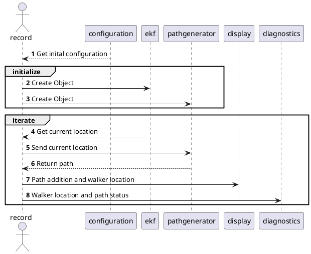
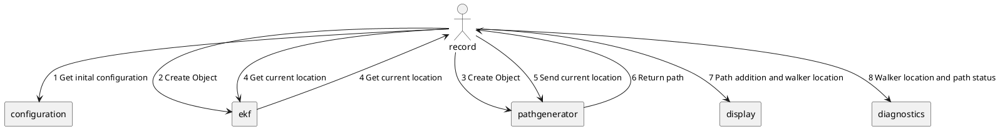

# Case E035

Diagram type: sequence · tier 2 · outcome: compiled low-structural
Image: `E035.png`

## Ground truth

## Answer (1 display-only lines removed; they are in `E035.stripped.txt`)

## Structural diff

Element F1 1.000 · Relationship F1 0.000

- nodes matched (6): `configuration`, `diagnostics`, `display`, `ekf`, `pathgenerator`, `record`
- nodes missed (0): none
- nodes spurious (0): none
- edges matched (0): none
- edges missed (8): `configuration -> record : message`, `ekf -> record : message`, `pathgenerator -> record : message`, `record -> diagnostics : message`, `record -> display : message`, `record -> ekf : message`, `record -> pathgenerator : message` ×2
- edges spurious (9): `ekf -> record : association (one arrowhead)`, `pathgenerator -> record : association (one arrowhead)`, `record -> configuration : association (one arrowhead)`, `record -> diagnostics : association (one arrowhead)`, `record -> display : association (one arrowhead)`, `record -> ekf : association (one arrowhead)` ×2, `record -> pathgenerator : association (one arrowhead)` ×2
