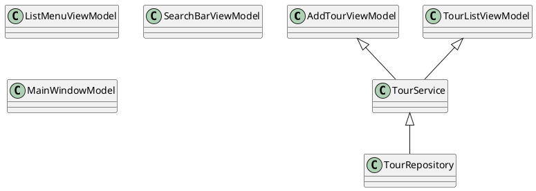
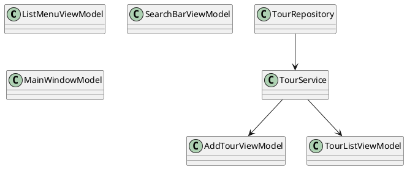

# Case E036

Diagram type: class · tier 1 · outcome: compiled low-structural
Image: `E036.png`

## Ground truth

## Answer (10 display-only lines removed; they are in `E036.stripped.txt`)

## Structural diff

Element F1 1.000 · Relationship F1 0.000

- nodes matched (7): `addtourviewmodel`, `listmenuviewmodel`, `mainwindowmodel`, `searchbarviewmodel`, `tourlistviewmodel`, `tourrepository`, `tourservice`
- nodes missed (0): none
- nodes spurious (0): none
- edges matched (0): none
- edges missed (3): `tourrepository -> tourservice : inheritance`, `tourservice -> addtourviewmodel : inheritance`, `tourservice -> tourlistviewmodel : inheritance`
- edges spurious (3): `tourrepository -> tourservice : association (one arrowhead)`, `tourservice -> addtourviewmodel : association (one arrowhead)`, `tourservice -> tourlistviewmodel : association (one arrowhead)`
