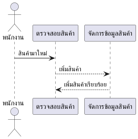

# Case E037

Diagram type: sequence · tier 1 · outcome: compile fail
Image: `E037.png`

## Ground truth



## Answer (0 display-only lines removed; they are in `E037.stripped.txt`)

```plantuml
@startuml
actor พนักงาน
participant ตรวจสอบสินค้า
participant จัดการข้อมูลสินค้า

พนักงาน -> ตรวจสอบสินค้า : สินค้ามาใหม่
ตรวจสอบสินค้า --> จัดการข้อมูลสินค้า : เพิ่มสินค้า
จัดการข้อมูลสินค้า --> ตรวจสอบสินค้า : เพิ่มสินค้าเรียบร้อย
@enduml
```

## Renderer

Renderer: error at line 2 of the answer block: `actor พนักงาน`
