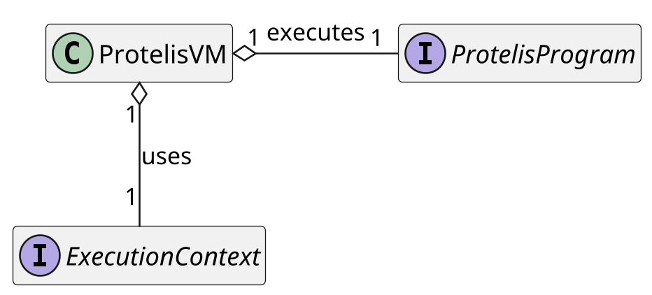

# Case E039

Diagram type: class · tier 1 · outcome: compile fail
Image: `E039.png`

## Ground truth

## Answer (427 display-only lines removed; they are in `E039.stripped.txt`)

## Renderer

The answer has no `@enduml`. Renderer: no PNG produced
