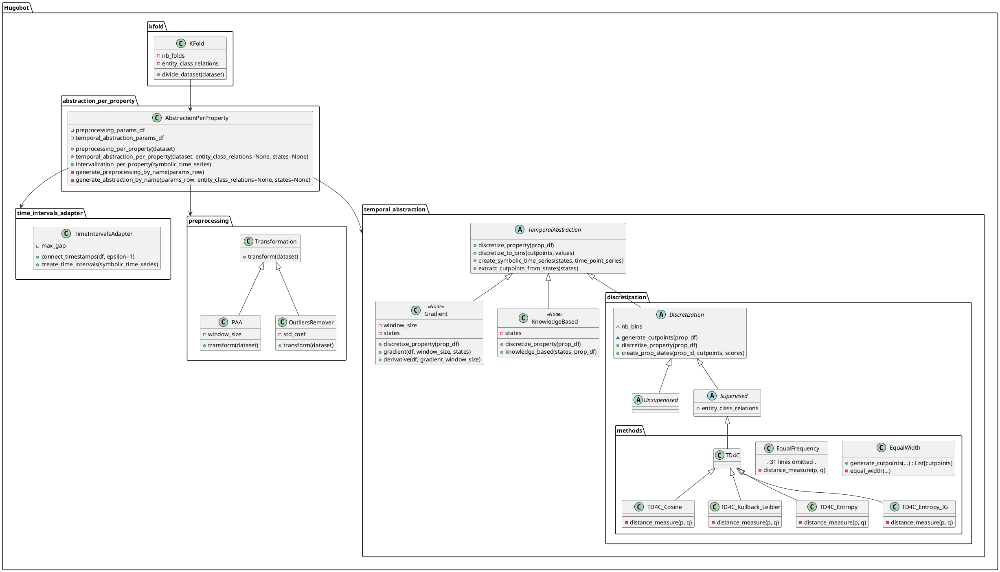

# Case E040

Diagram type: class · tier 4 · outcome: compiled low-structural
Image: `E040.png`

## Ground truth

```plantuml
' Blob ID: 1348037e5ef89ad46e650939b2d95a74c9b563b9
' Original Path: /Model/Hugobot/Diagrams/discretization_class_diagram.puml
' Source: World of Code

@startuml

package Hugobot {

    package time_intervals_adapter <<Node>> {

        class TimeIntervalsAdapter {
            -max_gap
            -connect_timestamps(df, epsilon=1)
            +create_time_intervals(symbolic_time_series)
        }
    }

    package preprocessing <<Node>> {
        class Transformation {
            {abstract} +transform(dataset)
        }

        class PAA {
            -window_size
            +transform(dataset)
        }

        class OutliersRemover {
            -std_coef
            +transform(dataset)
        }

        PAA -up-|> Transformation
        OutliersRemover -up-|> Transformation
    }

    package temporal_abstraction <<Node>> {

        abstract class TemporalAbstraction {
            {abstract} +discretize_property(prop_df)
            {static} +discretize_to_bins(cutpoints, values)
            {static} +create_symbolic_time_series(states, time_point_series)
            {static} +extract_cutpoints_from_states(states)
        }


        class Gradient <<Node>> {
            - window_size
            - states
            +discretize_property(prop_df)
            {static} +gradient(df, window_size, states)
            {static} +derivative(df, gradient_window_size)
        }

        class KnowledgeBased <<Node>> {
            -states
            +discretize_property(prop_df)
            {static} +knowledge_based(states, prop_df)
        }

        package discretization <<Node>> {
            abstract class Discretization {
                ~nb_bins
                {abstract} ~generate_cutpoints(prop_df)
                +discretize_property(prop_df)
                {static} +create_prop_states(prop_id, cutpoints, scores)
            }

            abstract class Unsupervised {
            }

            abstract class Supervised {
                ~entity_class_relations
            }

            package methods <<Node>> {
                class "Equal Width" {
                    +generate_cutpoints(...) : List[cutpoints]
                    {static} -equal_width(...)
                }

                class "Equal Frequency" {
                    +generate_cutpoints(...) : List[cutpoints]
                    {static} -equal_frequency(...)
                }

                class KMeans {
                    +generate_cutpoints(...) : List[cutpoints]
                    {static} -kmeans_adapter(...)
                }

                Class SAX {
                    +generate_cutpoints(...) : List[cutpoints]
                    {static} -sax(...)
                }

                package "td4c_persist" <<Node>> {
                    class Persist {
                        {static} -persist(...)
                        -all_states_persistance()
                        -single_state_persistence()
                        -calc_state_probabilities()
                        -calc_marginal_probabilities()
                    }

                    abstract class TD4C {
                        -DDM_scoring_function(df, cutoffs, entity_class_relations)
                        {abstract} -distance_measure(p, q)
                    }

                    class "TD4C Cosine" {
                        -distance_measure(p, q)
                    }

                    class "TD4C Kullback-Leibler" {
                        -distance_measure(p, q)
                    }

                    class "TD4C Entropy" {
                        -distance_measure(p, q)
                    }

                    class "TD4C Entropy IG" {
                        -distance_measure(p, q)
                    }

                    class "shared functions" {
                        ~candidate_selection()
                        ~generate_candidate_cutpoints()
                        ~symmetric_kullback_leibler()
                    }

                    "shared functions" -right- TD4C
                    "shared functions" -left- Persist
                    TD4C <|-- "TD4C Kullback-Leibler"
                    TD4C <|--  "TD4C Entropy"
                    TD4C <|--  "TD4C Entropy IG"
                    TD4C <|--  "TD4C Cosine"
                }
            }


            Discretization <|-- Supervised
            Discretization <|-- Unsupervised
            Unsupervised <|-- "Equal Width"
            Unsupervised <|-- "Equal Frequency"
            Unsupervised <|-- KMeans
            Unsupervised <|-- SAX
            Unsupervised <|-- "Persist"
            Supervised <|-- TD4C

        }

        Discretization -up-|> TemporalAbstraction
        Gradient -up-|> TemporalAbstraction
        KnowledgeBased -up-|> TemporalAbstraction
    }

    package kfold <<Node>> {
        class KFold {
            -nb_folds
            -entity_class_relations
            +divide_dataset(dataset)
        }
    }

    methods -[hidden]down- time_intervals_adapter
    time_intervals_adapter -[hidden]right- temporal_abstraction

    package abstraction_per_property <<Node>> {
        class AbstractionPerProperty {
            -preprocessing_params_df
            -temporal_abstraction_params_df
            +preprocessing_per_property(dataset)
            +temporal_abstraction_per_property(dataset, entity_class_relations=None, states=None)
            +intervalization_per_property(symbolic_time_series)
            -generate_preprocessing_by_name(params_row)
            -generate_abstraction_by_name(params_row, entity_class_relations=None, states=None)
        }
    }

    abstraction_per_property -down-> preprocessing
    abstraction_per_property -down-> temporal_abstraction
    abstraction_per_property -down-> time_intervals_adapter

    kfold --> abstraction_per_property
}
@enduml
```

## Answer (0 display-only lines removed; they are in `E040.stripped.txt`)

## Structural diff

Element F1 0.696 · Relationship F1 0.465

- nodes matched (16): `abstractionperproperty`, `discretization`, `gradient`, `kfold`, `kmeans`, `knowledgebased`, `outliersremover`, `paa`, `persist`, `sax`, `supervised`, `td4c`, `temporalabstraction`, `timeintervalsadapter`, `transformation`, `unsupervised`
- nodes missed (7): `equal frequency`, `equal width`, `shared functions`, `td4c cosine`, `td4c entropy`, `td4c entropy ig`, `td4c kullback-leibler`
- nodes spurious (7): `equalfrequency`, `equalwidth`, `shared_functions`, `td4c_cosine`, `td4c_entropy`, `td4c_entropy_ig`, `td4c_kullback_leibler`
- edges matched (10): `discretization -> temporalabstraction : inheritance`, `gradient -> temporalabstraction : inheritance`, `kmeans -> unsupervised : inheritance`, `knowledgebased -> temporalabstraction : inheritance`, `outliersremover -> transformation : inheritance`, `paa -> transformation : inheritance`, `sax -> unsupervised : inheritance`, `supervised -> discretization : inheritance`, `td4c -> supervised : inheritance`, `unsupervised -> discretization : inheritance`
- edges missed (13): `abstraction_per_property -> preprocessing : association (one arrowhead)`, `abstraction_per_property -> temporal_abstraction : association (one arrowhead)`, `abstraction_per_property -> time_intervals_adapter : association (one arrowhead)`, `equal frequency -> unsupervised : inheritance`, `equal width -> unsupervised : inheritance`, `kfold -> abstraction_per_property : association (one arrowhead)`, `persist -> shared functions : association`, `persist -> unsupervised : inheritance`, `shared functions -> td4c : association`, `td4c cosine -> td4c : inheritance`, `td4c entropy -> td4c : inheritance`, `td4c entropy ig -> td4c : inheritance`, `td4c kullback-leibler -> td4c : inheritance`
- edges spurious (10): `abstractionperproperty -> preprocessing : association (one arrowhead)`, `abstractionperproperty -> temporal_abstraction : association (one arrowhead)`, `abstractionperproperty -> time_intervals_adapter : association (one arrowhead)`, `equalfrequency -> unsupervised : inheritance`, `equalwidth -> unsupervised : inheritance`, `kfold -> abstractionperproperty : association (one arrowhead)`, `td4c_cosine -> td4c : inheritance`, `td4c_entropy -> td4c : inheritance`, `td4c_entropy_ig -> td4c : inheritance`, `td4c_kullback_leibler -> td4c : inheritance`
