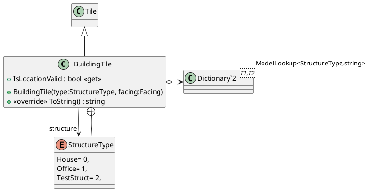

# Case E041

Diagram type: class · tier 2 · outcome: compile fail
Image: `E041.png`

## Ground truth



## Answer (1 display-only lines removed; they are in `E041.stripped.txt`)

```plantuml
@startuml

class Tile

class BuildingTile {
  + IsLocationValid : bool <<get>>
  --
  + BuildingTile(type:StructureType, facing:Facing)
  + <<override>> ToString() : string
}

enum StructureType {
  House=0,
  Office=1,
  TestStruct=2,
}

class "Dictionary`2" as Dictionary2

note right of Dictionary2
ModelLookup<StructureType,string>
end note

note top right of Dictionary2
T1,T2
end note

Tile <|-- BuildingTile

BuildingTile o--> Dictionary2

BuildingTile --> StructureType : structure
@enduml
```

## Renderer

Renderer: error at line 25 of the answer block: `note top right of Dictionary2`
