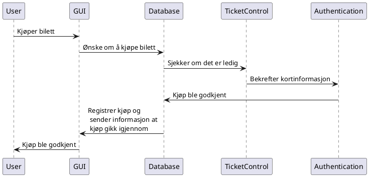
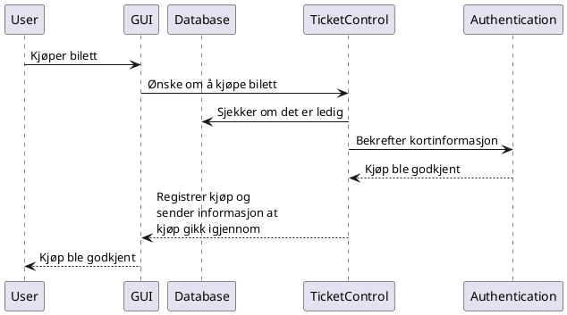

# Case E042

Diagram type: sequence · tier 1 · outcome: compiled low-structural
Image: `E042.png`

## Ground truth

## Answer (0 display-only lines removed; they are in `E042.stripped.txt`)

## Structural diff

Element F1 1.000 · Relationship F1 0.429

- nodes matched (5): `authentication`, `database`, `gui`, `ticketcontrol`, `user`
- nodes missed (0): none
- nodes spurious (0): none
- edges matched (3): `gui -> user : message`, `ticketcontrol -> authentication : message`, `user -> gui : message`
- edges missed (4): `authentication -> database : message`, `database -> gui : message`, `database -> ticketcontrol : message`, `gui -> database : message`
- edges spurious (4): `authentication -> ticketcontrol : message`, `gui -> ticketcontrol : message`, `ticketcontrol -> database : message`, `ticketcontrol -> gui : message`
