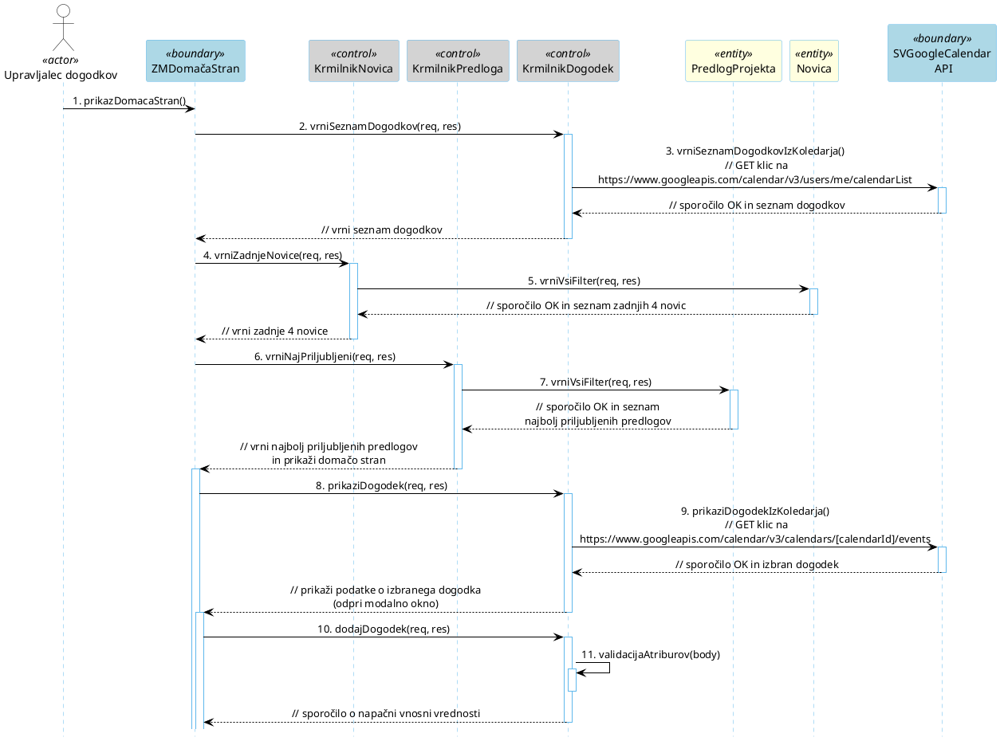

# Case E043

Diagram type: sequence · tier 4 · outcome: compile fail
Image: `E043.png`

## Ground truth



## Answer (9 display-only lines removed; they are in `E043.stripped.txt`)

```plantuml
@startuml

actor "" as User

participant "<<boundary>>\nZMDomačaStran" as ZMDomačaStran
participant "<<control>>\nKrmilnikNovica" as KrmilnikNovica
participant "<<control>>\nKrmilnikPredloga" as KrmilnikPredloga
participant "<<control>>\nKrmilnikDogodek" as KrmilnikDogodek
participant "<<entity>>\nPredlogProjekta" as PredlogProjekta <<entity>> #lightyellow
participant "<<entity>>\nNovica" as Novica <<entity>> #lightyellow
participant "<<boundary>>\nSVGoogleCalendar\nAPI" as SVGoogleCalendarAPI

activate KrmilnikDogodek
KrmilnikDogodek -> SVGoogleCalendarAPI : pridobiDogodke()
activate SVGoogleCalendarAPI
SVGoogleCalendarAPI --> KrmilnikDogodek : dogodki
deactivate SVGoogleCalendarAPI
deactivate KrmilnikDogodek

activate KrmilnikNovica
KrmilnikNovica -> Novica : pridobiNovice()
activate Novica
Novica --> KrmilnikNovica : novice
deactivate Novica
deactivate KrmilnikNovica

activate KrmilnikPredloga
KrmilnikPredloga -> PredlogProjekta : pridobiPredloge()
activate PredlogProjekta
PredlogProjekta --> KrmilnikPredloga : predlogi
deactivate PredlogProjekta
deactivate KrmilnikPredloga

User -> ZMDomačaStran : prikažiDomačoStran()
activate ZMDomačaStran

ZMDomačaStran -> KrmilnikDogodek : pridobiDogodke()
activate KrmilnikDogodek
KrmilnikDogodek -> SVGoogleCalendarAPI : pridobiDogodke()
activate SVGoogleCalendarAPI
SVGoogleCalendarAPI --> KrmilnikDogodek : dogodki
deactivate SVGoogleCalendarAPI
KrmilnikDogodek --> ZMDomačaStran : dogodki
deactivate KrmilnikDogodek

ZMDomačaStran -> KrmilnikDogodek : prikažiDogodke()
activate ZMDomačaStran
activate KrmilnikDogodek
KrmilnikDogodek --> ZMDomačaStran : prikazani dogodki
deactivate KrmilnikDogodek
deactivate ZMDomačaStran

deactivate ZMDomačaStran

@enduml
```

## Renderer

Renderer: error at line 12 of the answer block: `actor "" as User`
