# Case E044

Diagram type: class · tier 4 · outcome: compiled low-structural
Image: `E044.png`

## Ground truth

```plantuml
' Blob ID: 8bd6ca506bb9421da58c78cf22979ef203149446
' Original Path: /AlgoChess/src/main/java/edu/fiuba/algoChess/interfaz/controlladores/controlladores.plantuml
' Source: World of Code

@startuml

title __CONTROLLADORES's Class Diagram__\n

  namespace edu.fiuba.algoChess {
    namespace interfaz.controlladores {
      class edu.fiuba.algoChess.interfaz.controlladores.AceptarNombresHandler {
          - TFnombreJugador1 : TextField
          - TFnombreJugador2 : TextField
          - popupNombres : Popup
          - stage : Stage
          + AceptarNombresHandler()
          + handle()
      }
    }
  }
  

  namespace edu.fiuba.algoChess {
    namespace interfaz.controlladores {
      class edu.fiuba.algoChess.interfaz.controlladores.AtacarPiezaHandler {
          ~ stage : Stage
          ~ tFX : TextField
          ~ tFY : TextField
          + AtacarPiezaHandler()
          + handle()
      }
    }
  }
  

  namespace edu.fiuba.algoChess {
    namespace interfaz.controlladores {
      class edu.fiuba.algoChess.interfaz.controlladores.CancelarNombresHandler {
          - popupNombres : Popup
          - stage : Stage
          + CancelarNombresHandler()
          + handle()
      }
    }
  }
  

  namespace edu.fiuba.algoChess {
    namespace interfaz.controlladores {
      class edu.fiuba.algoChess.interfaz.controlladores.CrearPiezaHandler {
          ~ head : HBox
          ~ nombrePieza : String
          ~ stageUbicar : Stage
          ~ x : TextField
          ~ y : TextField
          + CrearPiezaHandler()
          + handle()
      }
    }
  }
  

  namespace edu.fiuba.algoChess {
    namespace interfaz.controlladores {
      class edu.fiuba.algoChess.interfaz.controlladores.CurarPiezaHandler {
          ~ stage : Stage
          ~ tFX : TextField
          ~ tFY : TextField
          + CurarPiezaHandler()
          + handle()
      }
    }
  }
  

  namespace edu.fiuba.algoChess {
    namespace interfaz.controlladores {
      class edu.fiuba.algoChess.interfaz.controlladores.IniciarJuegoHandler {
      }
    }
  }
  

  namespace edu.fiuba.algoChess {
    namespace interfaz.controlladores {
      class edu.fiuba.algoChess.interfaz.controlladores.JugarHandler {
          - stage : Stage
          + JugarHandler()
          + handle()
      }
    }
  }
  

  namespace edu.fiuba.algoChess {
    namespace interfaz.controlladores {
      class edu.fiuba.algoChess.interfaz.controlladores.SalirHandler {
          + handle()
      }
    }
  }
  

  namespace edu.fiuba.algoChess {
    namespace interfaz.controlladores {
      class edu.fiuba.algoChess.interfaz.controlladores.UbicarPiezaHandler {
          - head : HBox
          - listaPieza : HashMap<String, Class>
          - nombrePieza : String
          - stagePrincipal : Stage
          - stageUbicar : Stage
          - tFX : TextField
          - tFY : TextField
          + UbicarPiezaHandler()
          + alerta3seg()
          + handle()
      }
    }
  }
  

  edu.fiuba.algoChess.interfaz.controlladores.AceptarNombresHandler .up.|> javafx.event.EventHandler
  edu.fiuba.algoChess.interfaz.controlladores.AtacarPiezaHandler .up.|> javafx.event.EventHandler
  edu.fiuba.algoChess.interfaz.controlladores.AtacarPiezaHandler o-- edu.fiuba.algoChess.modelo.entidades.Pieza : emisor
  edu.fiuba.algoChess.interfaz.controlladores.AtacarPiezaHandler o-- edu.fiuba.algoChess.modelo.juego.Juego : juego
  edu.fiuba.algoChess.interfaz.controlladores.AtacarPiezaHandler o-- edu.fiuba.algoChess.interfaz.vista.SegundaEtapa : segundaEtapa
  edu.fiuba.algoChess.interfaz.controlladores.CancelarNombresHandler .up.|> javafx.event.EventHandler
  edu.fiuba.algoChess.interfaz.controlladores.CrearPiezaHandler .up.|> javafx.event.EventHandler
  edu.fiuba.algoChess.interfaz.controlladores.CrearPiezaHandler o-- edu.fiuba.algoChess.modelo.juego.Juego : juego
  edu.fiuba.algoChess.interfaz.controlladores.CrearPiezaHandler o-- edu.fiuba.algoChess.interfaz.vista.PantallaPrincipal : pantallaPrincipal
  edu.fiuba.algoChess.interfaz.controlladores.CurarPiezaHandler .up.|> javafx.event.EventHandler
  edu.fiuba.algoChess.interfaz.controlladores.CurarPiezaHandler o-- edu.fiuba.algoChess.modelo.entidades.Curandero : emisor
  edu.fiuba.algoChess.interfaz.controlladores.CurarPiezaHandler o-- edu.fiuba.algoChess.modelo.juego.Juego : juego
  edu.fiuba.algoChess.interfaz.controlladores.CurarPiezaHandler o-- edu.fiuba.algoChess.interfaz.vista.SegundaEtapa : segundaEtapa
  edu.fiuba.algoChess.interfaz.controlladores.JugarHandler .up.|> javafx.event.EventHandler
  edu.fiuba.algoChess.interfaz.controlladores.SalirHandler .up.|> javafx.event.EventHandler
  edu.fiuba.algoChess.interfaz.controlladores.UbicarPiezaHandler .up.|> javafx.event.EventHandler
  edu.fiuba.algoChess.interfaz.controlladores.UbicarPiezaHandler o-- edu.fiuba.algoChess.modelo.bandos.Bando : bandoPieza
  edu.fiuba.algoChess.interfaz.controlladores.UbicarPiezaHandler o-- edu.fiuba.algoChess.modelo.juego.Juego : juego
  edu.fiuba.algoChess.interfaz.controlladores.UbicarPiezaHandler o-- edu.fiuba.algoChess.interfaz.vista.VistaTablero : mapView
  edu.fiuba.algoChess.interfaz.controlladores.UbicarPiezaHandler o-- edu.fiuba.algoChess.interfaz.vista.PantallaPrincipal : pantallaPrincipal
  edu.fiuba.algoChess.interfaz.controlladores.UbicarPiezaHandler o-- edu.fiuba.algoChess.interfaz.vista.VistaPieza : pieceView


right footer


PlantUML diagram generated by SketchIt! (https://bitbucket.org/pmesmeur/sketch.it)
For more information about this tool, please contact philippe.mesmeur@gmail.com
endfooter

@enduml
```



## Answer (0 display-only lines removed; they are in `E044.stripped.txt`)

```plantuml
@startuml
package edu {
    package fiuba {
        package algoChess {
            package interfaz {
                package controladores {
                    class AceptarNombresHandler {
                        C
                        - TFnombreJugador1 : TextField
                        - TFnombreJugador2 : TextField
                        - popupNombres : Popup
                        - stage : Stage
                        + AceptarNombresHandler()
                        + handle()
                    }
                    class AtacarPiezaHandler {
                        C
                        - stage : Stage
                        - tFX : TextField
                        - tFY : TextField
                        + AtacarPiezaHandler()
                        + handle()
                    }
                    class CancelarNombresHandler {
                        C
                        - popupNombres : Popup
                        - stage : Stage
                        + CancelarNombresHandler()
                        + handle()
                    }
                    class CrearPiezaHandler {
                        C
                        - head : HBox
                        - nombrePieza : String
                        - stageUbicar : Stage
                        - x : TextField
                        - tFY : TextField
                        - y : TextField
                        + CrearPiezaHandler()
                        + handle()
                    }
                    class CurarPiezaHandler {
                        C
                        - stage : Stage
                        - tFX : TextField
                        - tFY : TextField
                        + CurarPiezaHandler()
                        + handle()
                    }
                    class IniciarJuegoHandler {
                        C
                    }
                    class JugarHandler {
                        C
                        - stage : Stage
                        + JugarHandler()
                        + handle()
                    }
                    class SalirHandler {
                        C
                        + handle()
                    }
                    class UbicarPiezaHandler {
                        C
                        - head : HBox
                        - listaPieza : HashMap<String, Class>
                        - nombrePieza : String
                        - stagePrincipal : Stage
                        - stageUbicar : Stage
                        - tFX : TextField
                        - tFY : TextField
                        + UbicarPiezaHandler()
                        + alerta3seg()
                        + handle()
                    }
                }
                package vista {
                    class SegundaEtapa {
                        C
                    }
                    class PantallaPrincipal {
                        C
                    }
                    class VistaTablero {
                        C
                    }
                    class VistaPieza {
                        C
                    }
                }
... 26 lines omitted ...
        interface EventHandler {
            C
        }
    }
}

AceptarNombresHandler ..|> EventHandler
AtacarPiezaHandler ..|> EventHandler
CancelarNombresHandler ..|> EventHandler
CrearPiezaHandler ..|> EventHandler
CurarPiezaHandler ..|> EventHandler
IniciarJuegoHandler ..|> EventHandler
JugarHandler ..|> EventHandler
SalirHandler ..|> EventHandler
UbicarPiezaHandler ..|> EventHandler

AtacarPiezaHandler -- SegundaEtapa : segundaEtapa
CrearPiezaHandler -- PantallaPrincipal : pantallaPrincipal
CurarPiezaHandler -- SegundaEtapa : segundaEtapa
IniciarJuegoHandler -- PantallaPrincipal : pantallaPrincipal
JugarHandler -- VistaTablero
SalirHandler -- VistaPieza : mapView
UbicarPiezaHandler -- VistaPieza : pieceView
UbicarPiezaHandler -- Pieza : emisor
UbicarPiezaHandler -- Juego : juego
UbicarPiezaHandler -- Juego : juego
UbicarPiezaHandler -- Juego : juego
UbicarPiezaHandler -- Bando : bandoPieza

@enduml
```

## Structural diff

Element F1 1.000 · Relationship F1 0.381

- nodes matched (18): `aceptarnombreshandler`, `atacarpiezahandler`, `bando`, `cancelarnombreshandler`, `crearpiezahandler`, `curandero`, `curarpiezahandler`, `eventhandler`, `iniciarjuegohandler`, `juego`, `jugarhandler`, `pantallaprincipal`, `pieza`, `salirhandler`, `segundaetapa`, `ubicarpiezahandler`, `vistapieza`, `vistatablero`
- nodes missed (0): none
- nodes spurious (0): none
- edges matched (8): `aceptarnombreshandler -> eventhandler : inheritance`, `atacarpiezahandler -> eventhandler : inheritance`, `cancelarnombreshandler -> eventhandler : inheritance`, `crearpiezahandler -> eventhandler : inheritance`, `curarpiezahandler -> eventhandler : inheritance`, `jugarhandler -> eventhandler : inheritance`, `salirhandler -> eventhandler : inheritance`, `ubicarpiezahandler -> eventhandler : inheritance`
- edges missed (13): `atacarpiezahandler -> juego : aggregation`, `atacarpiezahandler -> pieza : aggregation`, `atacarpiezahandler -> segundaetapa : aggregation`, `crearpiezahandler -> juego : aggregation`, `crearpiezahandler -> pantallaprincipal : aggregation`, `curarpiezahandler -> curandero : aggregation`, `curarpiezahandler -> juego : aggregation`, `curarpiezahandler -> segundaetapa : aggregation`, `ubicarpiezahandler -> bando : aggregation`, `ubicarpiezahandler -> juego : aggregation`, `ubicarpiezahandler -> pantallaprincipal : aggregation`, `ubicarpiezahandler -> vistapieza : aggregation`, `ubicarpiezahandler -> vistatablero : aggregation`
- edges spurious (13): `atacarpiezahandler -> segundaetapa : association`, `bando -> ubicarpiezahandler : association`, `crearpiezahandler -> pantallaprincipal : association`, `curarpiezahandler -> segundaetapa : association`, `iniciarjuegohandler -> eventhandler : inheritance`, `iniciarjuegohandler -> pantallaprincipal : association`, `juego -> ubicarpiezahandler : association` ×3, `jugarhandler -> vistatablero : association`, `pieza -> ubicarpiezahandler : association`, `salirhandler -> vistapieza : association`, `ubicarpiezahandler -> vistapieza : association`
