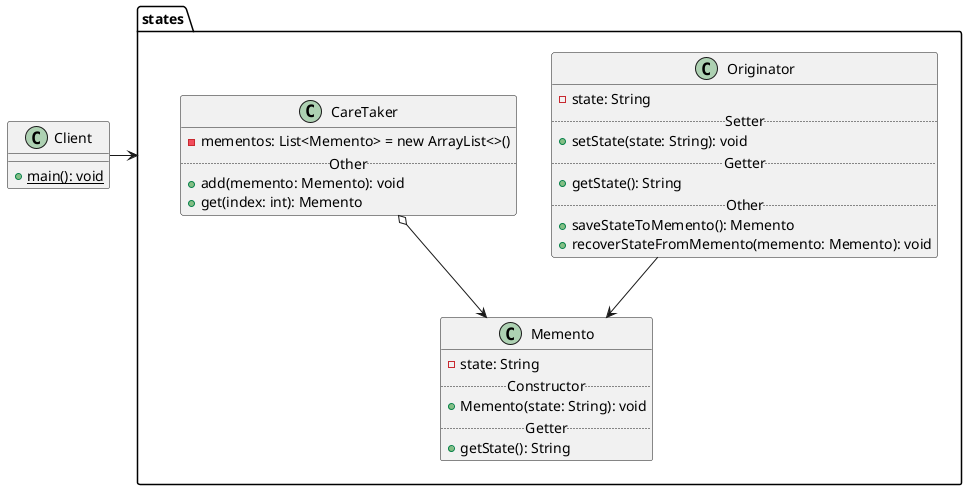

# Case E045

Diagram type: class · tier 3 · outcome: compile fail
Image: `E045.png`

## Ground truth



## Answer (1 display-only lines removed; they are in `E045.stripped.txt`)

```plantuml
@startuml

class "Client" {
  [C]
  main(): void
}

class "Originator" {
  [C]
  state: String
  +setState(state: String): void
  +getState(): String
  +saveStateToMemento(): Memento
  +recoverStateFromMemento(memento: Memento): void
}

class "CareTaker" {
  [C]
  mementos: List<Memento> = new ArrayList<>()
  +add(memento: Memento): void
  +get(index: int): Memento
}

class "Memento" {
  [C]
  state: String
  +Memento(state: String): void
  +getState(): String
}

package "states" {
  Originator
  CareTaker
  Memento
}

Client --> Originator
Originator --> Memento
CareTaker --> Memento

@enduml
```

## Renderer

Renderer: error at line 33 of the answer block: `Originator`
