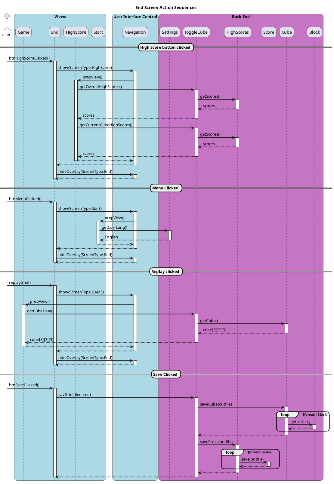

# Case E046

Diagram type: sequence · tier 4 · outcome: compile fail
Image: `E046.png`

## Ground truth



## Answer (1 display-only lines removed; they are in `E046.stripped.txt`)

```plantuml
@startuml

actor "User" as User

package "Views" {
  participant "Game" as Game
  participant "End" as End
  participant "HighScore" as HighScore
  participant "Start" as Start
}

package "User Interface Control" {
  participant "Navigation" as Navigation
}

package "Back End" {
  participant "Settings" as Settings
  participant "JoggleCube" as JoggleCube
  participant "HighScores" as HighScores
  participant "Score" as Score
  participant "Cube" as Cube
  participant "Block" as Block
}

User -> Game: btnHighScoreClicked()
Game -> End: show(ScreenType.HighScore)
End -> Navigation: prepView()
End -> HighScores: getOverallHighScores()
HighScores -> JoggleCube: getScores()
JoggleCube -> JoggleCube: scores
JoggleCube -> End: scores
End -> JoggleCube: getCurrentCubeHighScores()
JoggleCube -> JoggleCube: getScores()
JoggleCube -> JoggleCube: scores
JoggleCube -> End: scores
End -> Navigation: hideOverlay(ScreenType.End)
Navigation -> End: scores

User -> Game: btnMenuClicked()
Game -> Start: show(ScreenType.Start)
Start -> Navigation: prepView()
Start -> Settings: getCurrLang()
Settings -> Settings: English
Settings -> Start: English
Start -> Navigation: hideOverlay(ScreenType.End)
Navigation -> Start: English

User -> Game: replayGrid()
Game -> Start: show(ScreenType.GAME)
Start -> Navigation: prepView()
Start -> JoggleCube: getCubeData()
JoggleCube -> Cube: getCube()
Cube -> Cube: cube[3][3][3]
Cube -> Start: cube[3][3][3]
Start -> Navigation: hideOverlay(ScreenType.End)
Navigation -> Start: cube[3][3][3]

User -> Game: btnSaveClicked()
Game -> JoggleCube: savGrid(filename)
JoggleCube -> JoggleCube: saveCube(outfile)
JoggleCube -> Block: loop [foreach Block]
Block -> Block: getLetter()
Block -> JoggleCube: getLetter()
JoggleCube -> JoggleCube: saveScore(outfile)
JoggleCube -> Score: loop [foreach score]
Score -> Score: save(outfile)
Score -> JoggleCube: save(outfile)
JoggleCube -> JoggleCube: save(outfile)

@enduml
```

## Renderer

Renderer: error at line 7 of the answer block: `participant "Game" as Game`
