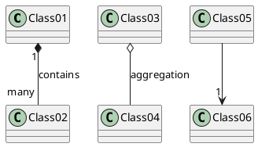
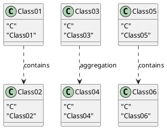

# Case E047

Diagram type: class · tier 1 · outcome: compiled low-structural
Image: `E047.png`

## Ground truth

## Answer (0 display-only lines removed; they are in `E047.stripped.txt`)

## Structural diff

Element F1 1.000 · Relationship F1 0.000

- nodes matched (6): `class01`, `class02`, `class03`, `class04`, `class05`, `class06`
- nodes missed (0): none
- nodes spurious (0): none
- edges matched (0): none
- edges missed (3): `class01 -> class02 : composition`, `class03 -> class04 : aggregation`, `class05 -> class06 : association (one arrowhead)`
- edges spurious (3): `class01 -> class02 : dependency`, `class03 -> class04 : dependency`, `class05 -> class06 : dependency`
