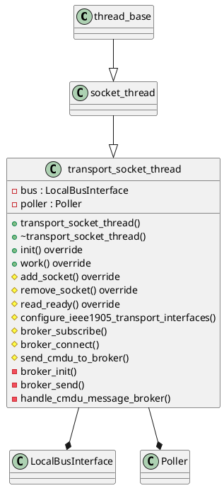
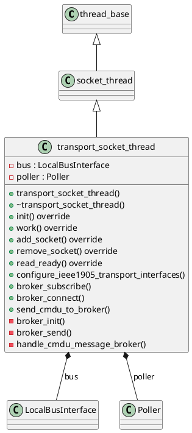

# Case E048

Diagram type: class · tier 3 · outcome: compiled low-structural
Image: `E048.png`

## Ground truth

## Answer (1 display-only lines removed; they are in `E048.stripped.txt`)

## Structural diff

Element F1 1.000 · Relationship F1 0.000

- nodes matched (5): `localbusinterface`, `poller`, `socket_thread`, `thread_base`, `transport_socket_thread`
- nodes missed (0): none
- nodes spurious (0): none
- edges matched (0): none
- edges missed (4): `localbusinterface -> transport_socket_thread : composition`, `poller -> transport_socket_thread : composition`, `socket_thread -> transport_socket_thread : inheritance`, `thread_base -> socket_thread : inheritance`
- edges spurious (4): `socket_thread -> thread_base : inheritance`, `transport_socket_thread -> localbusinterface : composition`, `transport_socket_thread -> poller : composition`, `transport_socket_thread -> socket_thread : inheritance`
