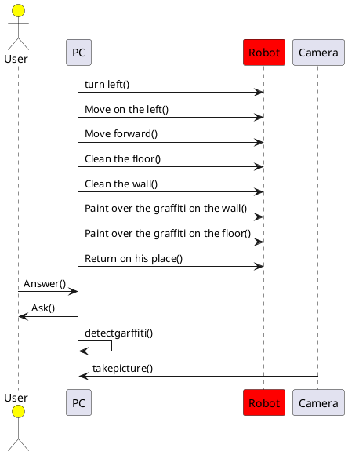
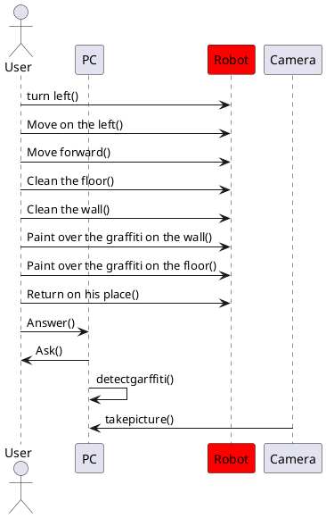

# Case E049

Diagram type: sequence · tier 2 · outcome: compiled low-structural
Image: `E049.png`

## Ground truth

## Answer (0 display-only lines removed; they are in `E049.stripped.txt`)

## Structural diff

Element F1 1.000 · Relationship F1 0.333

- nodes matched (4): `camera`, `pc`, `robot`, `user`
- nodes missed (0): none
- nodes spurious (0): none
- edges matched (4): `camera -> pc : message`, `pc -> pc : message`, `pc -> user : message`, `user -> pc : message`
- edges missed (8): `pc -> robot : message` ×8
- edges spurious (8): `user -> robot : message` ×8
