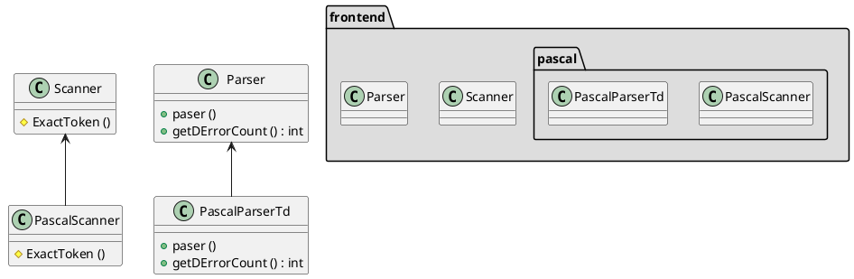

# Case E050

Diagram type: class · tier 2 · outcome: compile fail
Image: `E050.png`

## Ground truth



## Answer (0 display-only lines removed; they are in `E050.stripped.txt`)

```plantuml
@startuml

class Scanner {
    ◇ ExactToken ()
}

class Parser {
    + paser ()
    + getDErrorCount () : int
}

class PascalScanner {
    ◇ ExactToken ()
}

class PascalParserTd {
    + paser ()
    + getDErrorCount () : int
}

PascalScanner --|> Scanner
PascalParserTd --|> Parser

package "frontend" {
    package "pascal" {
        class PascalParserTd as FPT
        class PascalScanner as FPS
    }
    class Parser as FP
    class Scanner as FS
}

@enduml
```

## Renderer

Renderer: error at line 26 of the answer block: `class PascalParserTd as FPT`
