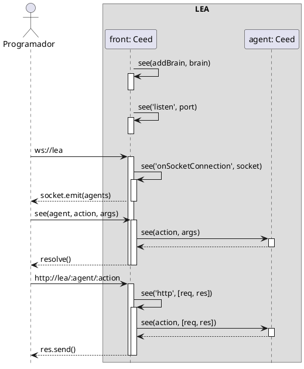
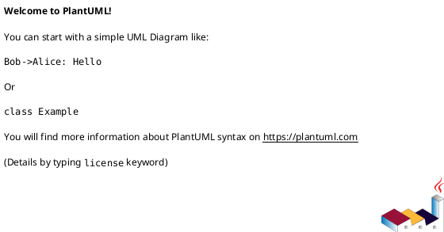

# Case E051

Diagram type: sequence · tier 3 · outcome: compile fail
Image: `E051.png`

## Ground truth

## Answer (221 display-only lines removed; they are in `E051.stripped.txt`)

## Renderer

The answer has no `@enduml`. Renderer: no PNG produced
